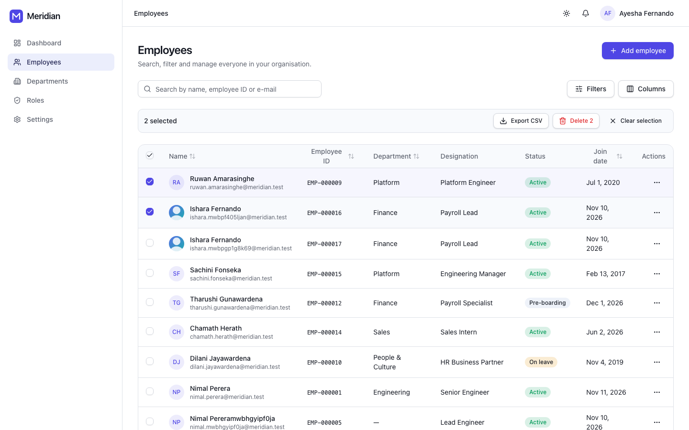
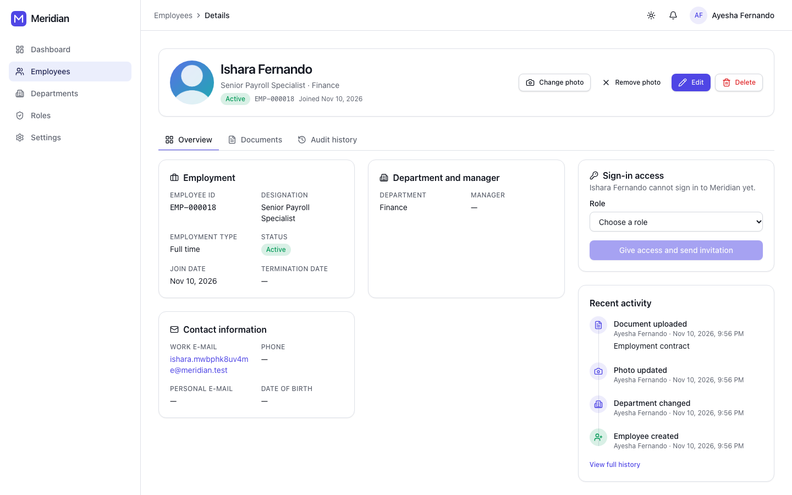
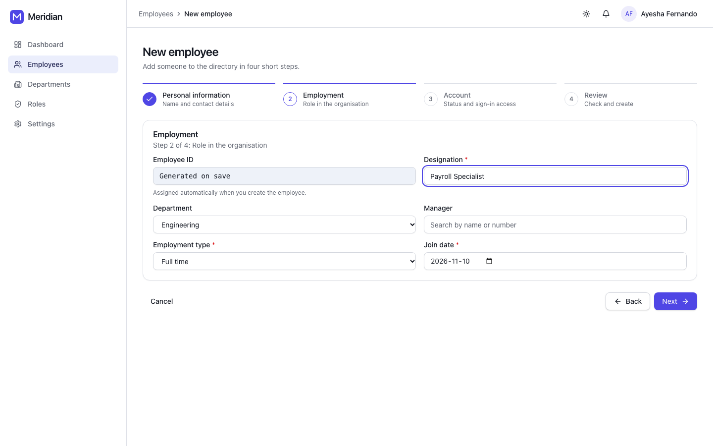
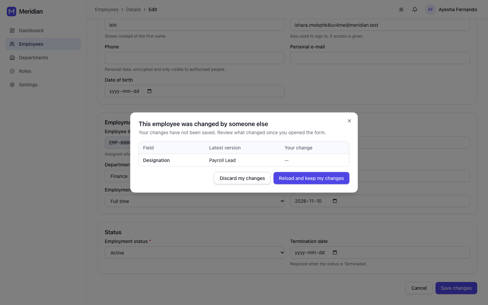

# Meridian — Enterprise Employee Management Platform

> A multi-tenant, audit-ready Employee Management System built as a **modular monolith** on Laravel, React, PostgreSQL, Docker and AWS.

Meridian manages the full employee lifecycle — onboarding, organisation structure, leave, attendance, compensation, documents and offboarding — with fine-grained, scope-aware access control and a tamper-evident audit trail.

This repository is a reference implementation. It shows how a production system is designed, documented, tested and run, not only how features are written.

---

## Design Principles

| Principle | What it means in this codebase |
|---|---|
| **Modular monolith first** | One deployable, strict module boundaries enforced by architecture tests. Modules can be split into services later without rewriting them. |
| **Domain over framework** | Business rules live in plain PHP domain classes. Laravel is the delivery mechanism, not the architecture. |
| **Secure by default** | Deny-by-default authorisation, PostgreSQL Row-Level Security as a second tenant barrier, PII encrypted at rest, MFA. |
| **Everything is auditable** | Every state change on sensitive data produces an immutable, hash-chained audit event. |
| **Operable** | Structured logs, distributed traces, health checks, runbooks, zero-downtime deploys. |
| **Contract-driven** | OpenAPI is the source of truth; frontend types and contract tests are generated from it. |
| **Decisions are written down** | Architecture Decision Records (ADRs) explain *why*, not just *what*. |

## Tech Stack

| Layer | Technology |
|---|---|
| Backend | PHP 8.3, Laravel 12, JWT (`firebase/php-jwt`) with rotating refresh tokens, queue workers on Amazon SQS |
| Frontend | React 19, TypeScript (strict), Vite, TanStack Query, React Router, React Hook Form + Zod, Tailwind CSS, shadcn/ui |
| Data | PostgreSQL 16 (RLS, partitioning), Redis 7 (cache, locks, rate limits) |
| Infrastructure | Docker, AWS ECS Fargate, RDS, ElastiCache, S3, CloudFront, SQS, SES, Secrets Manager, WAF |
| IaC / CI/CD | Terraform, GitHub Actions (OIDC to AWS), CodeDeploy blue/green |
| Observability | Monolog JSON → CloudWatch Logs, OpenTelemetry → AWS X-Ray, CloudWatch metrics & alarms, Sentry |
| Quality | Pest, Pest Arch, Pint, Larastan (level max), Infection, Vitest, Testing Library, MSW, Playwright, k6 |

## Documentation

| # | Document | Summary |
|---|---|---|
| 01 | [Overall Architecture](docs/01-architecture.md) | System context, containers, module map, request lifecycle |
| 02 | [Folder Structure](docs/02-folder-structure.md) | Monorepo layout, backend module anatomy, frontend feature slices |
| 03 | [Database Design](docs/03-database-design.md) | Schema, conventions, indexing, partitioning, RLS, encryption |
| 04 | [ER Diagram](docs/04-er-diagram.md) | Entity-relationship diagrams per bounded context |
| 05 | [API Structure](docs/05-api-structure.md) | REST conventions, versioning, errors, pagination, endpoint catalogue |
| 06 | [Authentication Flow](docs/06-authentication.md) | JWT access tokens, rotating refresh tokens, password reset, e-mail verification, MFA/SSO plan |
| 07 | [RBAC Design](docs/07-rbac.md) | Roles, permissions, scopes, policies, field-level access |
| 08 | [Deployment Architecture](docs/08-deployment.md) | AWS topology, environments, CI/CD, zero-downtime migrations, DR |
| 09 | [Logging & Observability](docs/09-logging-observability.md) | Structured logs, correlation, tracing, metrics, audit trail |
| 10 | [Testing Strategy](docs/10-testing-strategy.md) | Test pyramid, tooling, quality gates, test data |
| 11 | [Frontend Architecture](docs/11-frontend-architecture.md) | React app structure, API layer, auth flow, state management, components |
| 12 | [Employee Module](docs/12-employee-module.md) | Directory, wizard, conflicts, documents, accounts and audit history, from API to UI, with screenshots |
| — | [Architecture Decision Records](docs/adr/README.md) | Key decisions and their trade-offs |

## Getting Started (API)

**Requirements:** PHP 8.3+ (`pdo_pgsql`, `intl`, `sodium`), Composer 2, PostgreSQL 16.

```bash
cd apps/api
composer install
cp .env.example .env
php artisan key:generate
php -r "echo 'base64:'.base64_encode(random_bytes(64)).PHP_EOL;"   # paste into JWT_SECRET in .env
php artisan migrate
php artisan access:sync-permissions
php artisan identity:create-user admin@meridian.test --name="Ada Admin" --role=tenant_admin
php artisan serve
```

- Swagger UI: <http://localhost:8000/docs> (when `API_DOCS_ENABLED=true`)
- OpenAPI contract: [`packages/api-contract/spec/openapi.yaml`](packages/api-contract/spec/openapi.yaml)
- Verification e-mails are written to the log locally (`MAIL_MAILER=log`).

**Tests** run against a real PostgreSQL database (`meridian_test`; credentials in `apps/api/phpunit.xml`):

```bash
composer test            # Pest, in parallel
./vendor/bin/pint --test # code style
```

## Getting Started (Web)

**Requirements:** Node.js 22+, with the API running on `http://127.0.0.1:8000`.

```bash
cd apps/web
npm install
npm run dev        # http://localhost:5173 — proxies /api to the Laravel API
```

| Command | Purpose |
|---|---|
| `npm run api:generate` | Regenerate the typed client from `packages/api-contract/spec/openapi.yaml` |
| `npm run lint` / `npm run typecheck` | ESLint (incl. accessibility rules) and strict TypeScript |
| `npm test` | Vitest + Testing Library + MSW |
| `npm run test:e2e` | Playwright against the running API and app (see [docs/11 §9](docs/11-frontend-architecture.md#9-local-development)) |
| `npm run build` | Production build with per-page code splitting |
| `npm run docs:screenshots` | Regenerate `docs/screenshots` from the running app |

## Frontend at a Glance

- **Stack:** React 19 · TypeScript (strict) · Vite · React Router 7 · TanStack Query · React Hook Form + Zod · Tailwind CSS 4 + shadcn/ui (Radix) · Axios with an **Orval client generated from the OpenAPI contract**.
- **Auth:** the access token lives in memory only, and the refresh token in an HttpOnly cookie. Refresh is silent; concurrent 401s share one refresh (serialised across tabs with Web Locks) and are retried automatically. When a session ends, the user is redirected to sign-in and returned to their page afterwards.
- **Permissions:** navigation, pages, widgets and actions follow the permissions in `/me`. No role names are hard-coded.
- **Screens:**
  - dashboard with headcount, departments, recent employees, quick actions and recent activity;
  - employee directory: global search, advanced filters, department/join-date sorting, cursor paging, column selector (remembered), row selection with bulk delete, restore and CSV export, cards on phones;
  - employee profile with tabs (overview, documents, audit history), sign-in access and recent activity;
  - four-step create wizard, edit with a conflict dialog for concurrent changes, photo upload with drag and drop, crop and progress, soft delete with a required reason, restore;
  - departments, roles and settings (theme, sign out everywhere).
- **Quality:**
  - lazy-loaded pages with Suspense, skeletons, empty and error states;
  - keyboard and screen-reader support;
  - mobile, tablet and desktop layouts; light, dark and system themes;
  - tests at three levels: unit, integration (MSW) and E2E (Playwright, desktop + mobile).

### Employee module

| Directory | Profile |
|---|---|
|  |  |
|  |  |

More screenshots and the module's architecture: [docs/12 — Employee Module](docs/12-employee-module.md).

## Authentication at a Glance

| Endpoint | Purpose |
|---|---|
| `POST /api/v1/auth/login` | E-mail + password → 15-min JWT access token; refresh token in an `HttpOnly` cookie |
| `POST /api/v1/auth/refresh` | Single-use refresh-token rotation, with reuse detection that revokes the session |
| `POST /api/v1/auth/logout` · `logout-all` | End this session or every session (token-version bump) |
| `POST /api/v1/auth/forgot-password` · `reset-password` | Enumeration-safe password reset that signs out everywhere |
| `GET /api/v1/auth/email/verify/{id}/{hash}` | Signed, expiring verification link; resend endpoint available |
| `GET /api/v1/me` | Current user with roles and effective permissions |
| `GET /api/v1/permissions` · `roles` | RBAC catalogue (requires `access.manage`) |

## Employees at a Glance

| Endpoint | Purpose |
|---|---|
| `GET /api/v1/employees` | Directory with free-text search (`q`), whitelisted filters (`filter[name\|employee_number\|email\|job_title]`, `filter[status]=active,on_leave`, `filter[hire_date][gte]=…`, `filter[trashed]=only`), multi-field `sort=-hire_date,department` and cursor pagination |
| `POST` · `GET` · `PATCH` `/api/v1/employees[/{id}]` | Create, read and update with validation, generated employee numbers and **optimistic locking** (`ETag` / `If-Match`) |
| `DELETE /api/v1/employees/{id}` · `POST …/restore` | Soft delete with a required reason, and restore; blocked while the employee still has direct reports |
| `GET` · `POST /api/v1/employees/{id}/account` · `PUT …/account/role` | The employee's sign-in account: invitation by e-mail, one role ([ADR-0007](docs/adr/0007-employee-sign-in-accounts.md)) |
| `GET` · `POST /api/v1/employees/{id}/documents` · `GET /documents/{id}/download` · `DELETE /documents/{id}` | Contracts, ID proofs (confidential) and certificates, privately stored |
| `GET` · `POST` · `DELETE /api/v1/employees/{id}/photo` | Profile photo: content-sniffed image upload, private storage, streamed only to authorised users |
| `GET /api/v1/audit-events` | Hash-chained, tamper-evident audit trail of every change, with personal data masked |
| `GET` · `POST` · `PATCH` · `DELETE /api/v1/departments[/{id}]` | Department tree with unique codes, cycle protection and delete guards |
| `GET /api/v1/employees/headcount` | Active employees in total and per status |

Personal data (`personal_email`, `phone`, `date_of_birth`) is encrypted at rest. It is only returned with `employee.view.sensitive` and only writable with `employee.update.sensitive`.

Errors follow RFC 9457 (`application/problem+json`) with stable `code`s and a `request_id`. Design: [docs/06](docs/06-authentication.md), [ADR-0006](docs/adr/0006-jwt-access-and-rotating-refresh-tokens.md).

## Roadmap

| Phase | Scope |
|---|---|
| **1 — Foundation** | Monorepo, Docker dev environment, CI pipeline, Identity (✅ JWT auth, password reset, e-mail verification; MFA next), Tenancy, RBAC (✅ roles & permissions; scopes next), Audit (✅ hash-chained trail) |
| **2 — Core HR** | Organisation (✅ departments; positions, locations next), Employee profiles (✅ CRUD, search, photos, soft delete with reason, sign-in accounts), Documents (✅ upload, confidentiality; S3 presigned URLs next), **Web app (✅ foundation, auth, dashboard, full employee module, departments, roles, settings)** |
| **3 — Time** | Leave policies and requests with approval workflow, Attendance |
| **4 — Compensation** | Salary history, bands, field-level protection |
| **5 — Production** | Terraform for AWS, blue/green deploys, dashboards, load tests, runbooks |
| **6 — Extensions** | SSO (OIDC/SAML), reporting exports, webhooks, performance reviews |

## Licence

MIT
