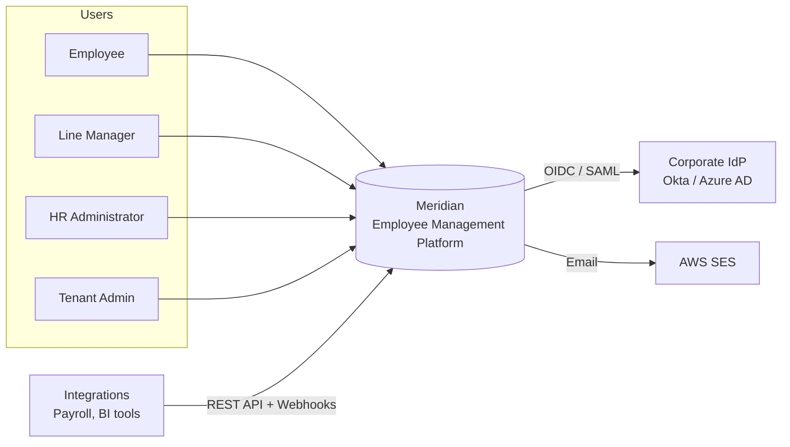
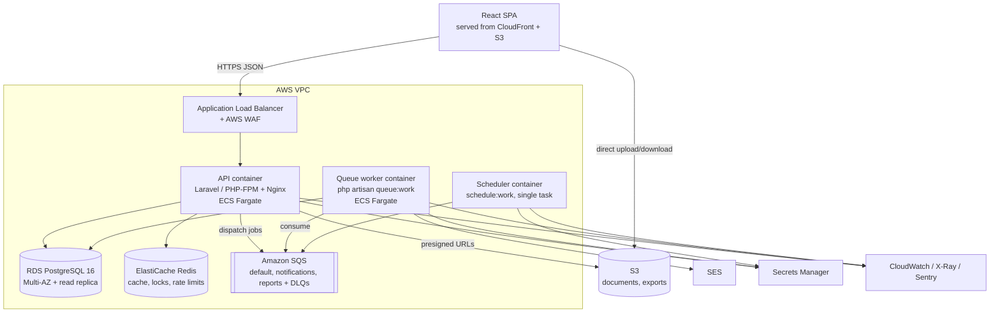
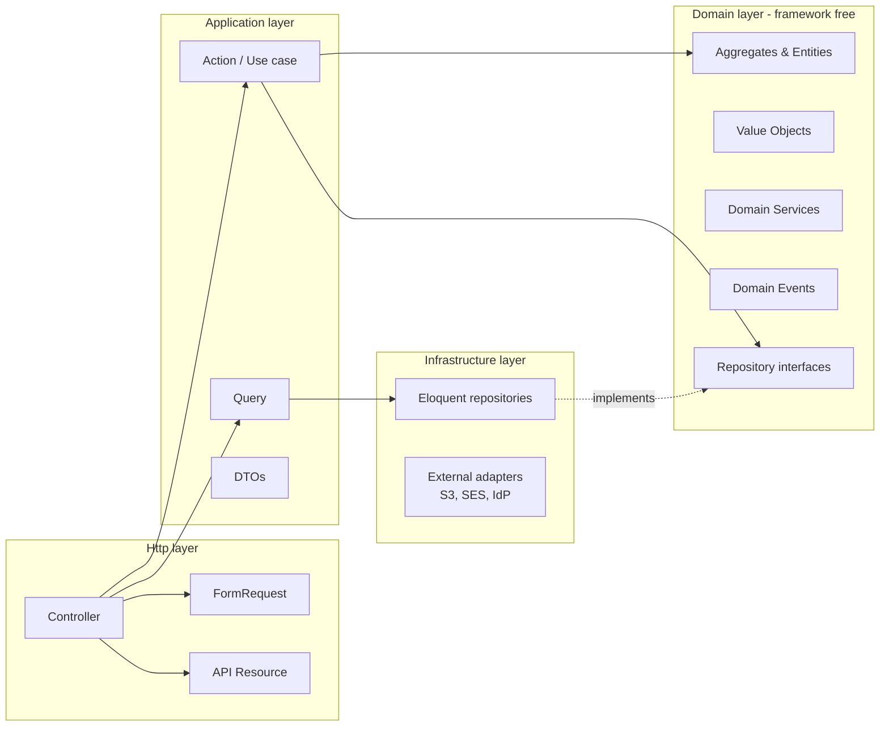
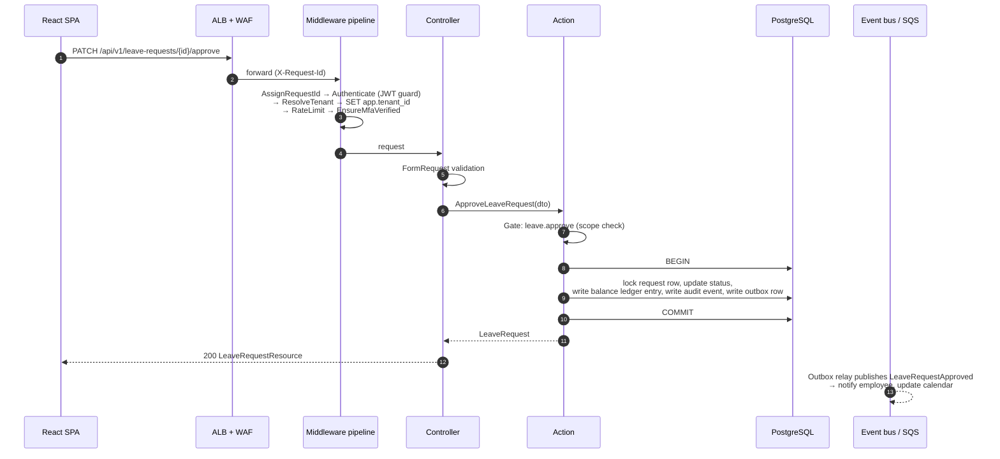

# 01 — Overall Architecture

## 1. Goals and Constraints

### Functional scope

| Bounded context | Responsibility |
|---|---|
| **Identity** | Users, credentials, JWT access tokens, rotating refresh tokens, MFA, SSO |
| **Tenancy** | Organisations (tenants), subscription settings, feature flags |
| **Access** | Roles, permissions, scoped role assignments |
| **Organisation** | Departments (tree), positions, job grades, locations, cost centres |
| **Employee** | Employee profile, employment records, reporting lines, emergency contacts, lifecycle (onboard → active → offboard) |
| **Leave** | Leave types, policies, balances (ledger), requests, approval workflow, public holidays |
| **Attendance** | Clock-in/out, timesheets, shifts |
| **Compensation** | Salary history, pay bands, allowances (sensitive data) |
| **Documents** | Employee files on S3, versioning, expiry tracking |
| **Audit** | Immutable, hash-chained event log of every sensitive change |
| **Notification** | Email, in-app notifications, user preferences |

### Quality attributes (non-functional requirements)

| Attribute | Target |
|---|---|
| Availability | 99.9% monthly (multi-AZ, no single point of failure) |
| Latency | p95 < 300 ms for reads, < 600 ms for writes at 200 req/s |
| Scale | 500 tenants, 250k employees total, 10k concurrent users |
| Security | OWASP ASVS Level 2, tenant isolation enforced in app **and** database |
| Recovery | RPO ≤ 5 min, RTO ≤ 1 h |
| Compliance readiness | GDPR (export, erasure via anonymisation), full audit trail |
| Maintainability | New module added without changing existing modules; 90%+ domain coverage |

### Constraints

- Team of 1–6 engineers → operational simplicity beats theoretical scalability.
- Stack fixed: Laravel, React, PostgreSQL, Docker, AWS.

## 2. Architectural Style: Modular Monolith

Meridian is **one deployable unit split into strictly isolated modules**, each matching a bounded context.

**Why not microservices?** (see [ADR-0001](adr/0001-modular-monolith.md))

- Distributed transactions, network failures and service-to-service auth add cost without benefit at this scale.
- A single PostgreSQL database keeps leave approvals, balance changes and audit records in one ACID transaction.
- Module boundaries give the same design discipline; any module can be extracted later because it only talks to others through **contracts** and **events**.

### Module rules (enforced by Pest Arch tests in CI)

1. A module may only depend on another module's `Contracts` namespace (interfaces + DTOs), never its internals.
2. Each module owns its tables. No cross-module joins in repositories; read models that need joins live in a dedicated `Reporting` query layer.
3. Cross-module side effects go through **domain events** (in-process, optionally queued), not direct calls.
4. `Domain` code has no dependency on Laravel (`Illuminate\*`) — only PHP and the shared kernel.

## 3. C4 — System Context

## 4. C4 — Container View

**The same Docker image** runs as API, worker and scheduler; only the command differs. This guarantees code parity across process types.

## 5. Layered Architecture Inside a Module

Each module follows a **hexagonal (ports & adapters)** layering:

| Layer | Contains | May depend on |
|---|---|---|
| **Http** | Controllers (thin), FormRequests, API Resources, route files | Application |
| **Application** | Actions (one use case each, e.g. `ApproveLeaveRequest`), Queries, DTOs, transaction boundaries, authorisation calls | Domain, other modules' `Contracts` |
| **Domain** | Entities, Value Objects (`EmployeeNumber`, `Money`, `DateRange`), domain services, events, repository interfaces, domain exceptions | Shared kernel only |
| **Infrastructure** | Eloquent models and repositories, adapters for AWS, mail, IdP | Domain, Laravel |

**Pragmatism note:** simple CRUD modules (e.g. Locations) may use Eloquent models directly in Actions. The full domain model is reserved for modules with real business rules (Leave, Employee lifecycle, Compensation). This is deliberate and documented in [ADR-0004](adr/0004-pragmatic-ddd.md).

## 6. Request Lifecycle

## 7. Cross-Cutting Concerns

| Concern | Approach |
|---|---|
| **Multi-tenancy** | Shared database, `tenant_id` on every tenant-owned table. Enforced by (1) a global Eloquent scope and (2) PostgreSQL RLS using `SET LOCAL app.tenant_id`. See [ADR-0002](adr/0002-multi-tenancy-rls.md). |
| **Transactions** | Actions own transaction boundaries. Controllers and repositories never start transactions. |
| **Events** | Domain events dispatched after commit. Events that leave the process use a **transactional outbox** table so they are never lost or sent for rolled-back changes. |
| **Idempotency** | `Idempotency-Key` header on POST endpoints, stored in Redis for 24 h. |
| **Concurrency** | Optimistic locking with a `version` column on aggregates (`If-Match` / ETag), pessimistic `SELECT … FOR UPDATE` for balance changes. |
| **Caching** | Redis, tag-free key schema `tenant:{id}:{module}:{key}`, cache invalidated by domain events. Permission sets cached per user. |
| **Feature flags** | Per-tenant flags in `tenant_features`, evaluated via a `Features` contract (Laravel Pennant). |
| **Time & money** | All timestamps stored in UTC (`timestamptz`); tenant time zone applied at the edge. Money as integer minor units + ISO currency code. |
| **Configuration** | 12-factor: env vars only, secrets from AWS Secrets Manager injected by ECS. |
| **Internationalisation** | API returns codes, SPA translates (i18next). Dates as ISO-8601. |

## 8. Frontend Architecture

- **SPA** built with Vite, deployed as static assets to S3 + CloudFront.
- **Feature-sliced** structure: each feature (employees, leave, …) owns its routes, API hooks, components and types.
- **Server state** in TanStack Query (cache, retries, optimistic updates). **Client state** kept minimal (Zustand for UI-only state such as sidebar, theme).
- **Types generated from OpenAPI** (`openapi-typescript`) so frontend and backend cannot drift silently.
- **Forms** with React Hook Form + Zod schemas; server validation errors mapped onto fields.
- **Permission-aware UI**: the `/me` endpoint returns effective permissions; a `<Can permission="employee.update">` component hides controls. The backend remains the only real enforcement point.
- **Accessibility**: WCAG 2.1 AA, checked with axe in Playwright.

## 9. Evolution Path

| Trigger | Response |
|---|---|
| Reporting queries slow down OLTP | Route `Reporting` queries to the read replica; later stream to a warehouse via CDC |
| One module needs independent scaling (e.g. Attendance at high write volume) | Extract it: its `Contracts` become an HTTP/gRPC client, its events move from outbox to SNS/SQS |
| Large enterprise tenant requires isolation | Tenant-per-schema or dedicated RDS instance; the tenant resolver already abstracts the connection |
