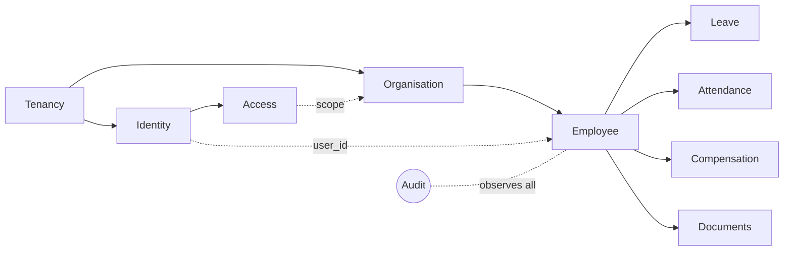
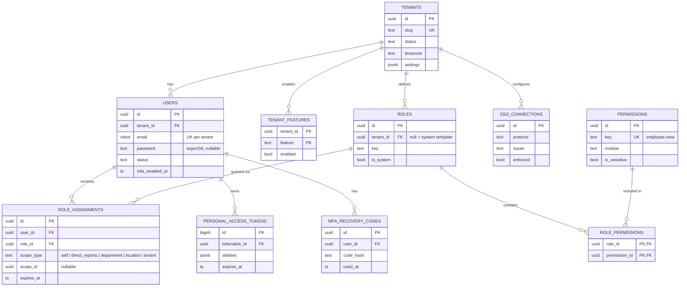
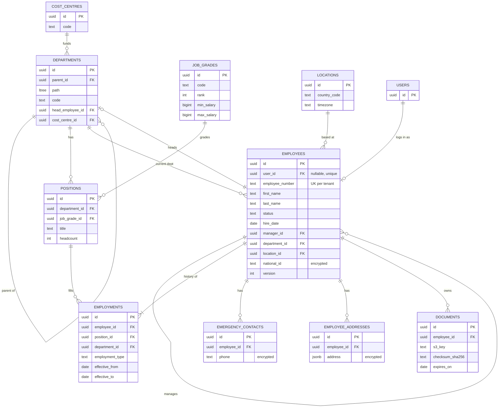
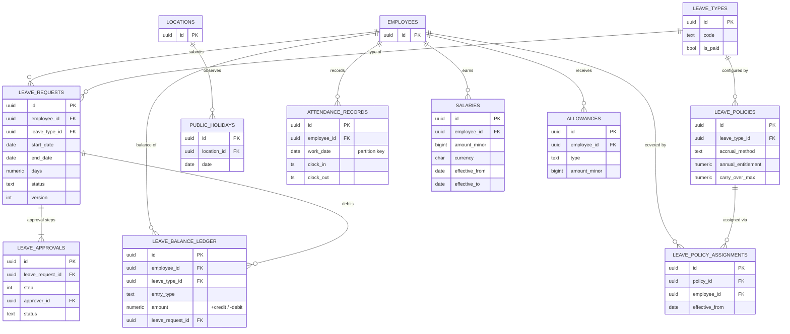
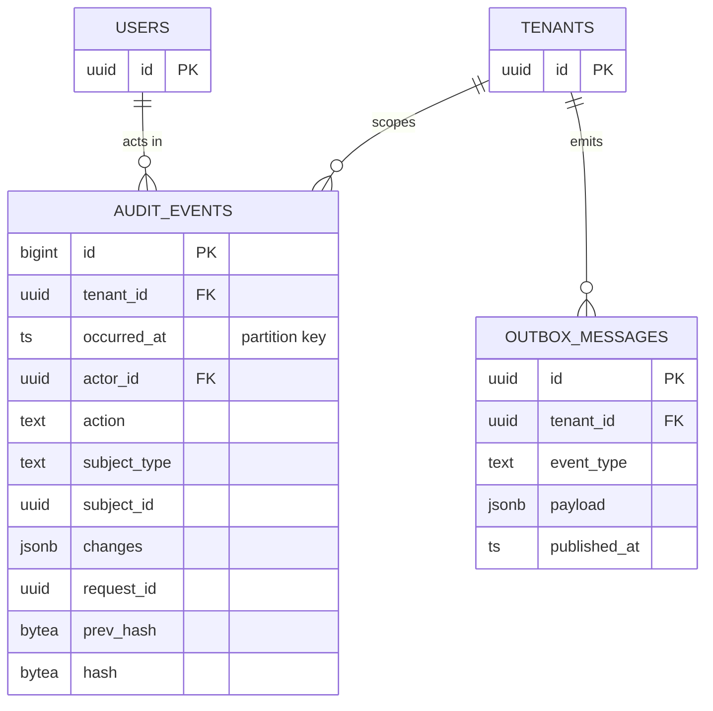

# 04 — ER Diagram

Diagrams are written in Mermaid so GitHub renders them and they stay version-controlled with the schema. Full column definitions are in [03-database-design.md](03-database-design.md); diagrams show keys and the most important attributes only.

`tenant_id` exists on every tenant-owned table. It is omitted from relationships below to keep diagrams readable.

## 1. High-Level Context Map

## 2. Identity, Tenancy & Access

## 3. Organisation & Employee

## 4. Leave, Attendance & Compensation

## 5. Platform Tables

## 6. Key Relationship Rules

| Relationship | Rule |
|---|---|
| User ↔ Employee | Optional 1:1. An employee may exist without a login (e.g. factory staff); a user may exist without an employee record (e.g. external auditor). |
| Employee → Manager | Self-reference. A database trigger rejects cycles (A manages B manages A). |
| Department tree | `parent_id` for integrity, `ltree path` for querying. Path is rebuilt in the same transaction when a department moves. |
| Employment / Salary history | Effective-dated, non-overlapping (exclusion constraint). The current row has `effective_to IS NULL`. |
| Leave balance | Derived from the ledger. The ledger is never updated or deleted; corrections are `reversal` entries. |
| Audit events | No foreign key to subjects: subjects may be anonymised or deleted, the audit record must survive. |
