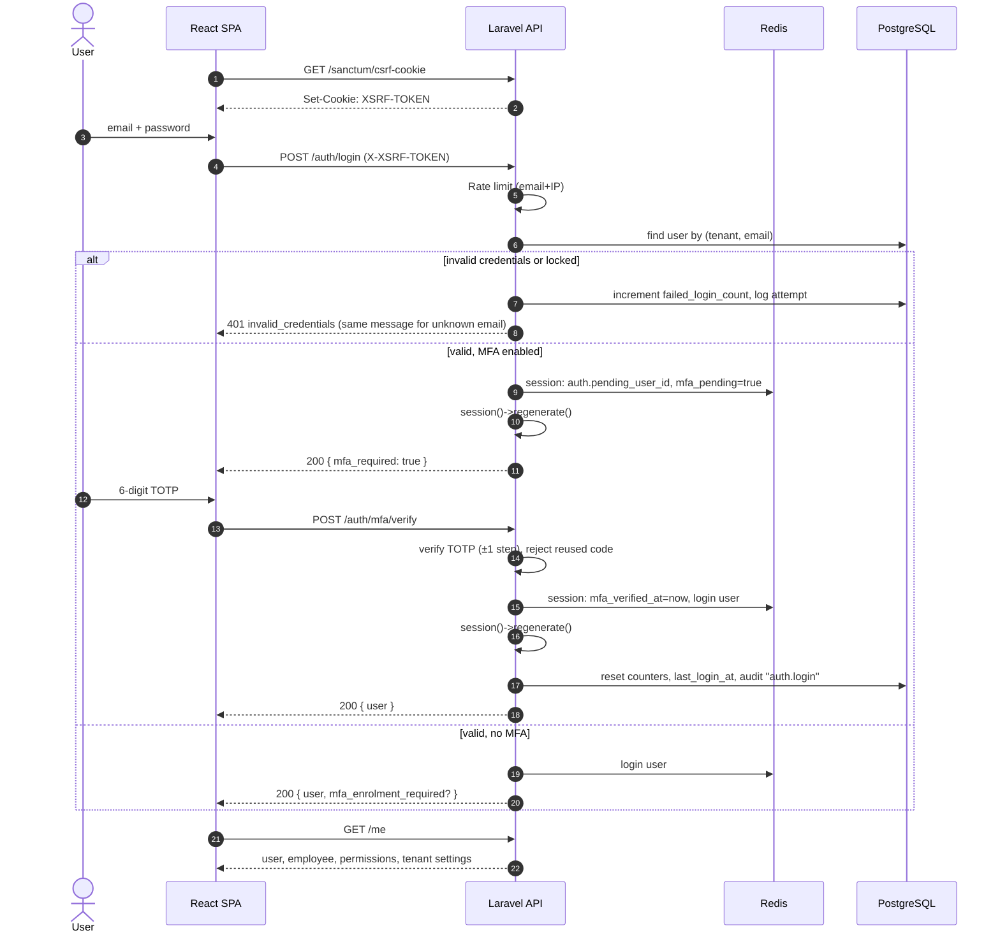
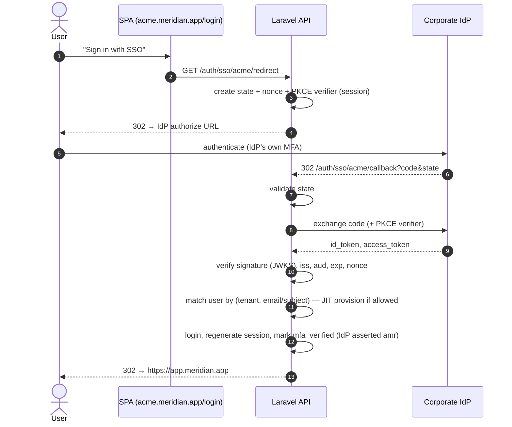

# 06 — Authentication Flow

## 1. Overview

| Client | Mechanism | Why |
|---|---|---|
| **React SPA** (first-party) | Laravel Sanctum **stateful cookie sessions** + CSRF token | Session cookie is `HttpOnly` → JavaScript (and XSS) cannot read it. No tokens in `localStorage`. Server-side sessions can be revoked instantly. |
| **Integrations / scripts** | Sanctum **personal access tokens** with abilities and expiry | Simple bearer tokens, scoped to a subset of permissions, revocable |
| **Enterprise tenants** | **OIDC** (Okta, Azure AD/Entra ID, Google) and **SAML 2.0** | Corporate SSO, central offboarding |
| **Second factor** | TOTP (RFC 6238) + one-time recovery codes; WebAuthn planned | Required for admin roles, tenant-configurable for everyone |

**Why not JWT for the SPA?** Self-contained JWTs cannot be revoked before they expire without a deny-list (which brings server state back), and storing them in browser storage exposes them to XSS. The SPA and API share a parent domain, so cookie sessions are the simpler and safer choice. See [ADR-0003](adr/0003-spa-session-auth.md).

## 2. Domain & Cookie Setup

```text
SPA:  https://app.meridian.app      (CloudFront)
API:  https://api.meridian.app      (ALB)
```

| Setting | Value |
|---|---|
| `SANCTUM_STATEFUL_DOMAINS` | `app.meridian.app` |
| `SESSION_DOMAIN` | `.meridian.app` |
| `SESSION_DRIVER` | `redis` |
| Session cookie | `__Host-` style naming not possible across subdomains → `Secure`, `HttpOnly`, `SameSite=Lax` |
| CORS | Allow origin `https://app.meridian.app` only, `supports_credentials: true` |
| Session lifetime | 30 min idle, 12 h absolute (tenant-configurable) |

## 3. Password Login (with MFA)



### Key details

- **Session fixation:** session ID regenerated after password step and again after MFA.
- **User enumeration:** login and forgot-password return identical responses and similar timing for unknown emails.
- **Lockout:** 5 failures → locked 15 min (exponential on repeat); admins can unlock. Lockout events notify the user by email.
- **MFA gate:** `EnsureMfaVerified` middleware blocks every route except MFA endpoints while `mfa_pending` is set. Tenants can set MFA to `optional`, `required_for_admins` or `required_for_all`; users without MFA under a required policy are forced into enrolment.
- **TOTP replay:** last used time-step stored per user; the same code cannot be used twice.
- **Step-up auth:** sensitive actions (view salaries, change roles, export PII) require MFA within the last 15 min (`password.confirm`-style middleware with TOTP).

## 4. SSO (OIDC) Flow



- When a tenant sets SSO to `enforced`, password login is disabled for its users (break-glass admin account excepted, MFA mandatory).
- **SCIM 2.0** provisioning endpoint is on the roadmap so IdP deactivation disables the user automatically.

## 5. Personal Access Tokens (Integrations)

```text
Authorization: Bearer 12|kM3x...  (shown once on creation, stored as SHA-256 hash)
```

| Control | Rule |
|---|---|
| Abilities | Subset of the creating user's permissions (`employee.view`, `leave.view`) — never more |
| Expiry | Required, max 1 year |
| Scope | Same scope as the user's role assignments; the effective permission is the intersection of token abilities and current user permissions, so revoking a role also limits the token |
| Audit | `last_used_at`, `last_used_ip`; creation/revocation audited |
| Restriction | Tokens cannot call identity endpoints (change password, MFA, create tokens) |

## 6. Password Policy

- argon2id (memory 64 MB, time 4, threads 1).
- Minimum 12 characters; no forced composition rules (NIST 800-63B). Checked against Have I Been Pwned using k-anonymity (`Password::uncompromised()`).
- Last 5 password hashes cannot be reused.
- Reset tokens: single-use, 30 min expiry, hashed in DB. All sessions revoked after a password reset.

## 7. Logout & Session Management

- `POST /auth/logout` invalidates the session and rotates the CSRF token.
- `/me/sessions` lists active sessions (device, IP, last activity) from a Redis index per user; users can revoke any session.
- Admin **disable user** → all sessions and tokens revoked immediately (Redis keys deleted, tokens deleted).
- **Impersonation** (support): only `platform.support` role, requires a reason, time-limited (30 min), shown with a banner in the UI, every action audited with `impersonator_id`.

## 8. Authentication Middleware Pipeline

```text
api (group)
 ├─ AssignRequestId
 ├─ SecurityHeaders           (HSTS, no-sniff, frame-deny; CSP served by CloudFront for SPA)
 ├─ EnsureFrontendRequestsAreStateful   (Sanctum)
 ├─ auth:sanctum
 ├─ ResolveTenant             (from user/token; sets TenantContext + PostgreSQL app.tenant_id)
 ├─ EnsureUserIsActive
 ├─ EnsureMfaVerified
 ├─ ThrottleRequests:api
 └─ (route-level) can:permission / RequireRecentMfa
```

## 9. Threats and Mitigations

| Threat | Mitigation |
|---|---|
| XSS steals credentials | HttpOnly session cookie, strict CSP, React auto-escaping, no `dangerouslySetInnerHTML` (lint rule) |
| CSRF | Sanctum XSRF token + `SameSite=Lax` + CORS allow-list |
| Credential stuffing | Rate limits, lockout, breached-password check, WAF bot rules, MFA |
| Session hijack | Secure cookies, rotation on privilege change, idle timeout, session list + revoke |
| Token leakage | Hashed at rest, shown once, expiry, minimal abilities, secret scanning in CI |
| Cross-tenant login | Users unique per tenant; tenant comes from the login subdomain and is verified against the user record |
