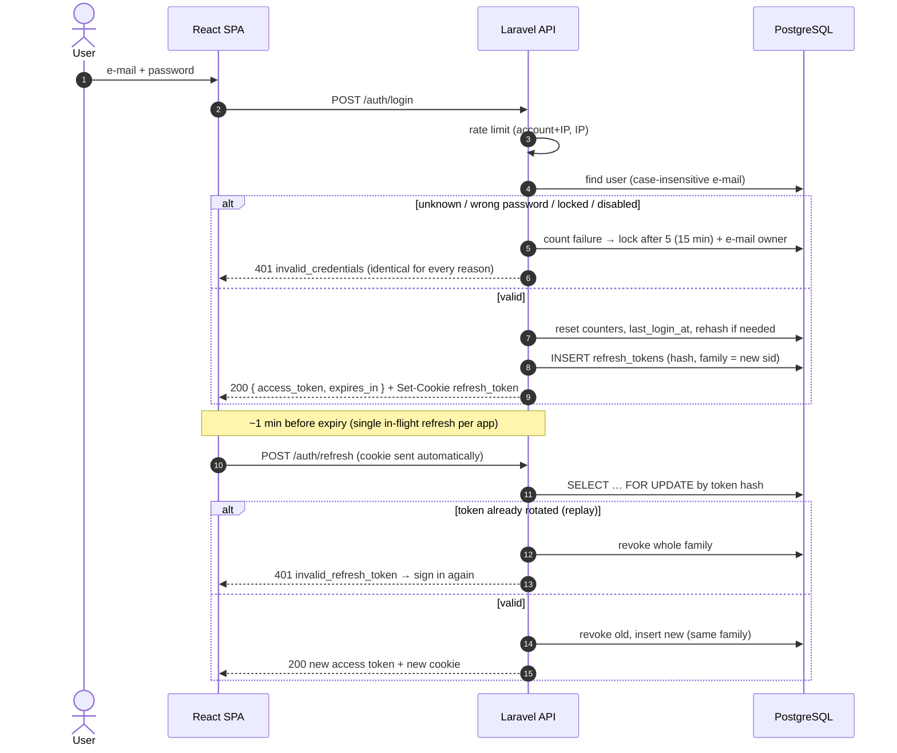

# 06 — Authentication Flow

> **Status:** password login, JWT access tokens, rotating refresh tokens, logout, password reset, e-mail verification and coarse RBAC are **implemented** (`apps/api/src/Modules/Identity`). MFA, SSO, tenancy and personal access tokens are designed below and still to be built.
> Decision record: [ADR-0006](adr/0006-jwt-access-and-rotating-refresh-tokens.md), which supersedes ADR-0003.

## 1. Overview

| Credential | Format | Lifetime | Where the client keeps it | How it is revoked |
|---|---|---|---|---|
| **Access token** | JWT, HS256, `kid` header | 15 min | SPA memory only (never `localStorage`) | Expiry; `jti` deny-list on logout; `ver` claim bump on logout-all / password reset; user disabled |
| **Refresh token** | Opaque 512-bit random, stored as SHA-256 | 14 days, **single-use** | `HttpOnly; Secure; SameSite=Strict` cookie, `Path=/api/v1/auth` | Rotation, family revocation, logout |
| **Password reset token** | Laravel broker token, hashed | 30 min, single-use | E-mail link to the SPA | Used once or expired |
| **E-mail verification link** | Signed URL (HMAC with `APP_KEY`) | 60 min | E-mail | Expiry; bound to the current address |

**Access token claims**

| Claim | Meaning |
|---|---|
| `iss`, `aud` | Issuer (API URL) and audience (`meridian-api`); both verified |
| `sub` | User id |
| `jti` | Token id, used for the logout deny-list |
| `sid` | Session id = refresh-token family id |
| `ver` | User's `token_version` when issued; must still match |
| `iat`, `nbf`, `exp` | Issue time, not-before, expiry (30 s leeway for clock skew) |

## 2. Login and Token Refresh



### Key details

- **User enumeration:** unknown accounts trigger a dummy hash check, so timing and response are the same as a wrong password. Forgot-password always answers `202`.
- **Lockout:** after 5 consecutive wrong passwords the account is locked for 15 minutes and the owner gets an e-mail. A successful login or a password reset clears the counter.
- **Hash upgrades:** if the hashing algorithm or cost changes, passwords are re-hashed transparently on the next successful login.
- **Reuse detection:** a refresh token that was already rotated means someone copied it, so the whole family is revoked (OAuth 2.0 Security BCP §4.14).
- **Concurrent refresh:** the token row is locked with `SELECT … FOR UPDATE`, so two parallel refreshes cannot both succeed.
- **Unverified e-mail:** users can sign in, call `/me`, re-send the link and log out. Every other endpoint answers `403 email_not_verified`.

## 3. Request Authentication (JWT guard)

`Auth::viaRequest('jwt', BearerTokenAuthenticator)` registers a standard Laravel guard named `api`. For each request it:

1. reads `Authorization: Bearer <jwt>`;
2. verifies the signature with the pinned algorithm (so `alg: none` and algorithm-confusion tokens are rejected), plus `kid`, `typ`, `iss`, `aud`, `nbf` and `exp`;
3. loads the user and rejects the token if the user is disabled or locked, if `ver` ≠ `users.token_version`, or if `jti` is on the deny-list;
4. stores the claims on the request (logout needs `sid`/`jti`) and adds `user_id` to the log context.

Any failure → `401 unauthenticated` with `WWW-Authenticate: Bearer`. The reason is never disclosed.

## 4. Logout and Session Revocation

| Action | Effect |
|---|---|
| `POST /auth/logout` | Revokes the refresh-token family (`sid`), puts the access token's `jti` on the deny-list until it expires, clears the cookie |
| `POST /auth/logout-all` | Increments `users.token_version` (every access token is now invalid) and revokes every refresh token of the user |
| Password reset | Same as logout-all, plus clears any lockout and marks the e-mail as verified |
| Admin disables user | Takes effect on the next request: the guard rejects non-active users |

Expired refresh tokens are kept for 30 days for investigations, then pruned daily (`model:prune`).

## 5. Password Reset

1. `POST /auth/forgot-password {email}` → always `202`. Active accounts get an e-mail with a link to `{FRONTEND_URL}/reset-password?token=…&email=…`. Laravel's broker throttles to one e-mail per minute per account.
2. `POST /auth/reset-password {token, email, password, password_confirmation}` → `204`, or `422 invalid_password_reset_token`.

## 6. E-mail Verification

1. Accounts are created unverified (`php artisan identity:create-user`, and later the user-invite API), and a verification e-mail is sent.
2. The e-mail link is a **signed, expiring API URL**: `GET /api/v1/auth/email/verify/{id}/{hash}?expires=…&signature=…`. The hash binds the link to the current address.
3. The API verifies the address and redirects to `{FRONTEND_URL}/email-verified`. An invalid, expired or tampered link redirects to `/email-verification-failed`.
4. `POST /auth/email/verification-notification` re-sends the link (rate limited).

## 7. Password Policy

- argon2id in deployed environments (memory 64 MB, time 4, threads 1).
- Minimum 12 characters, maximum 1024, and no composition rules (NIST 800-63B). Passwords are checked against Have I Been Pwned with k-anonymity (`Password::uncompromised()`), so the password itself never leaves the server.
- *Planned:* the last 5 password hashes cannot be reused.

## 8. Middleware Pipeline

```text
global
 ├─ AssignRequestId           X-Request-Id in/out, shared via Context with logs and jobs
 └─ SecurityHeaders           HSTS, nosniff, frame DENY; deny-all CSP + no-store on /api
api (group)
 ├─ ForceJsonResponse
 ├─ SubstituteBindings
 └─ ThrottleRequests:api      300/min per user (or IP)
route
 ├─ auth:api                  JWT guard (above)
 ├─ "authenticated" group     = auth:api + EnsureEmailIsVerified (used by every non-auth module)
 ├─ throttle:identity.*       login, refresh, password reset, verification limiters
 └─ can:<permission>          RBAC gate per permission (docs/07)
```

*Planned additions:* `ResolveTenant` (sets PostgreSQL `app.tenant_id`), `EnsureMfaVerified` and `RequireRecentMfa`.

## 9. Planned: MFA and SSO

- **MFA:** TOTP (RFC 6238) with recovery codes. The login response returns `mfa_required` and a short-lived MFA challenge token; `POST /auth/mfa/verify` exchanges it for the token pair. An `amr` claim records the factors used, and step-up checks require recent MFA for sensitive permissions.
- **SSO (OIDC / SAML):** the authorization-code flow with PKCE ends by issuing the same token pair. With SSO enforced, password login is disabled for the tenant (except a break-glass admin with MFA).
- **Personal access tokens:** for integrations. They will be scoped to a subset of the user's permissions, expire within a year at most, be stored as hashes and be audited.

## 10. Threats and Mitigations

| Threat | Mitigation |
|---|---|
| XSS steals the refresh token | `HttpOnly` cookie, never in the response body |
| XSS uses the access token | 15-minute lifetime, in-memory only, strict CSP, React escaping, lint ban on `dangerouslySetInnerHTML` |
| CSRF on `/auth/refresh` | `SameSite=Strict`, cookie path limited to `/api/v1/auth`, CORS allow-list; the response is only readable by the allowed origin |
| Stolen refresh token | Single-use rotation with family revocation on replay |
| Forged / altered JWT | Algorithm pinned, signature, `kid`, `iss`, `aud` and time claims verified |
| Credential stuffing / brute force | Per-account and per-IP rate limits, lockout with owner notification, breached-password check, WAF |
| User enumeration | Identical errors and timing; forgot-password always 202 |
| Leaked database | Refresh and reset tokens stored only as hashes; passwords hashed with argon2id |
| Leaked signing key | `kid` allows rotation; rotating the secret invalidates every access token within 15 minutes |
