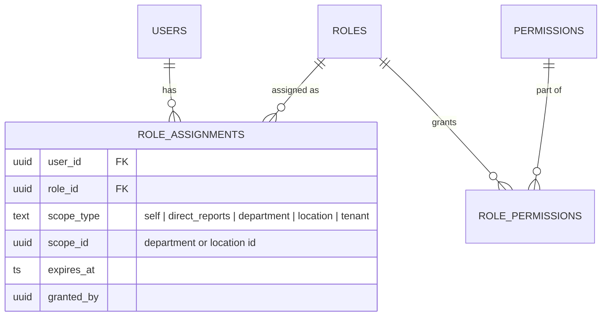
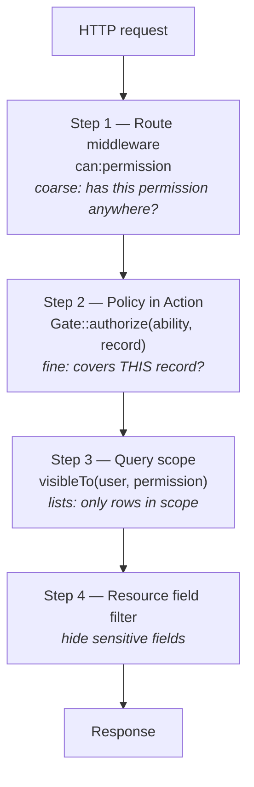

# 07 — RBAC Design

## 1. Requirements

Plain "role → permission" RBAC is not enough for HR. A line manager may approve leave — but **only for their own team**. An HR partner may edit employees — but **only in the regions they cover**. Salary data must be hidden even from people who can see the rest of a profile.

Meridian therefore uses **scoped RBAC**:

> A user is granted a **role** at a **scope**. A role is a set of **permissions**. A permission check asks: *does any of the user's assignments include this permission at a scope that covers this record?*

| Concept | Example |
|---|---|
| Permission | `leave.approve` |
| Role | `line_manager` = { `employee.view`, `leave.view`, `leave.approve`, `attendance.view` } |
| Scope | `self`, `direct_reports`, `department` (incl. sub-departments), `location`, `tenant` |
| Assignment | Ayesha → `hr_partner` @ `department:Engineering` (expires 2027-03-31) |

## 2. Data Model



- **Permissions** are defined in code (a PHP enum per module) and synced to the table by a deploy step. Code is the source of truth, so a permission can never be referenced without existing.
- **System roles** (`tenant_id IS NULL`) are templates cloned into each tenant on creation. Tenants may create custom roles but cannot edit system ones.
- **Assignments** can expire — useful for acting managers and temporary auditors.

## 3. Permission Catalogue

| Module | Permissions | Sensitive |
|---|---|---|
| Employee | `employee.view`, `employee.create`, `employee.update`, `employee.update.sensitive`, `employee.view.sensitive`, `employee.transfer`, `employee.terminate`, `employee.export`, `employee.delete` | `*.sensitive`, `export` |
| Organisation | `organisation.view`, `organisation.manage` | |
| Leave | `leave.view`, `leave.request.on_behalf`, `leave.approve`, `leave.adjust`, `leave.configure` | |
| Attendance | `attendance.view`, `attendance.manage`, `attendance.configure` | |
| Compensation | `compensation.view`, `compensation.manage` | ✔ (step-up MFA) |
| Documents | `document.view`, `document.upload`, `document.delete`, `document.view.confidential` | ✔ |
| Access | `access.manage`, `user.manage` | ✔ |
| Audit | `audit.view` | |
| Tenant | `tenant.manage`, `integration.manage` | ✔ |

**Implicit self permissions:** every employee can view their own profile, update their own contact details and emergency contacts, view their own leave balances, create their own leave requests and clock in/out. These are modelled as an always-present `employee_self` role at `self` scope, not hard-coded `if` statements.

## 4. Default Roles

| Role | Typical scope | Key permissions |
|---|---|---|
| `employee_self` | self | self-service (implicit, every user with an employee record) |
| `line_manager` | direct_reports (auto-assigned when someone reports to you) | `employee.view`, `leave.view`, `leave.approve`, `attendance.view` |
| `department_head` | department | line manager + `employee.update`, `organisation.view` |
| `hr_partner` | department / location | `employee.*` (not compensation), `leave.*`, `attendance.*`, `document.*` |
| `hr_admin` | tenant | all employee (incl. `employee.delete`), leave, attendance, organisation, document permissions + `employee.export` |
| `payroll_officer` | tenant / location | `employee.view`, `compensation.view`, `compensation.manage` |
| `auditor` | tenant | read-only everything + `audit.view`; no sensitive fields |
| `tenant_admin` | tenant | `access.manage`, `user.manage`, `tenant.manage`, `integration.manage`, `audit.view` |
| `platform_support` | platform | impersonation only; never assigned by tenants |

**Separation of duties:** `tenant_admin` does *not* automatically get HR data permissions. A user who manages access cannot silently read salaries — they would have to grant themselves a role, which is audited and alerts other admins.

## 5. Scope Resolution

| Scope | Covers employee E when… | Query filter (SQL) |
|---|---|---|
| `self` | `E.user_id = current user` | `employees.user_id = :uid` |
| `direct_reports` | `E.manager_id = my employee id` | `employees.manager_id = :eid` |
| `department` | E's department path is under the scope department | `departments.path <@ :scope_path` (ltree, GiST-indexed) |
| `location` | `E.location_id = scope_id` | `employees.location_id = :lid` |
| `tenant` | always (RLS already restricts to tenant) | no extra filter |

A user can hold many assignments; the effective visible set is the **union** of all scopes that include the requested permission.

## 6. Enforcement Points

Authorisation is checked at three layers. Each layer has one job.



1. **Route middleware** — fast rejection: user has `leave.approve` in *some* assignment.
2. **Policies** — record-level, called inside the Action (not only the controller) so the rule applies to API, console and queue entry points alike.
   ```text
   LeaveRequestPolicy::approve(User $user, LeaveRequest $request):
       deny if $request->employee->user_id === $user->id     // cannot approve own leave
       return $authz->allows($user, 'leave.approve', $request->employee)
   ```
3. **Query scopes** — list endpoints apply `Employee::query()->visibleTo($user, 'employee.view')`, which compiles all of the user's scopes into a single `WHERE (… OR …)` clause. Unauthorised rows are never loaded and pagination counts are correct.
4. **Field-level filtering** — API Resources include sensitive attributes only when the user holds the matching permission for that record:
   ```text
   'national_id'   => $this->whenCan('employee.view.sensitive', fn () => $this->national_id)
   'date_of_birth' => $this->whenCan('employee.view.sensitive', …)
   ```
   On write, `FormRequest` rejects sensitive fields the user cannot update (`403`, not silently ignored).

Not-visible records return **404**, not 403, so users cannot probe for existence.

## 7. The `Authorizer` Service

A single service owns all decisions. Policies and query scopes delegate to it, so the rules are written once.

```text
interface Authorizer
    allows(User, permission, ?subject): bool
    scopeQuery(Builder, User, permission): Builder
    effectivePermissions(User): PermissionSet       // for /me and the UI
```

### Caching

- A user's compiled assignments (`permission → [scopes]`) are cached in Redis: `tenant:{t}:authz:user:{u}`, TTL 10 min.
- Cache is busted by events: `RoleAssignmentChanged`, `RolePermissionsChanged`, `EmployeeManagerChanged`, `DepartmentMoved`.
- Per-request memoisation avoids repeated Redis hits.

## 8. Approval Routing (Leave)

The approver is resolved at submission time and stored on `leave_approvals`, so later org changes do not move an in-flight request silently.

1. Step 1: the employee's `manager_id`. If none or it is the requester, escalate to the department head.
2. Optional step 2 (policy rule, e.g. > 10 days): HR partner for the employee's department.
3. **Delegation:** a manager on leave can delegate approvals (time-boxed assignment of `leave.approve` at `direct_reports` scope of the delegator).
4. Self-approval is always blocked, even for `hr_admin`.

## 9. Frontend Usage

- `/me` returns `permissions: ["employee.view", "leave.approve", …]` (scope-free, for menus).
- Each resource returns `meta.permissions` for record-specific actions (`["approve", "reject"]`).
- `<Can permission="leave.approve">` and `useCan(resource, "approve")` hide controls.
- The UI is a convenience. Every rule is enforced by the API.

## 10. Auditing & Governance

- Every role/permission/assignment change is an audit event with before/after state.
- Granting any **sensitive** permission emails all other tenant admins.
- Quarterly **access review** report: all assignments per user, last login, last use of each sensitive permission — supports SOC 2 / ISO 27001 style reviews.

## 11. Testing the RBAC Model

- **Policy matrix test:** a data-driven Pest test runs every (role × scope × permission × record relationship) combination against an expected-outcome table kept in `tests/Fixtures/rbac-matrix.php`. Changing a rule without updating the matrix fails CI.
- **Endpoint coverage test:** reflects over all registered routes and fails if any `/api/v1` route lacks a `can:` middleware or an explicit `->public()` marker.
- **Cross-tenant test:** see [03 §3](03-database-design.md#3-multi-tenant-isolation-with-row-level-security).
