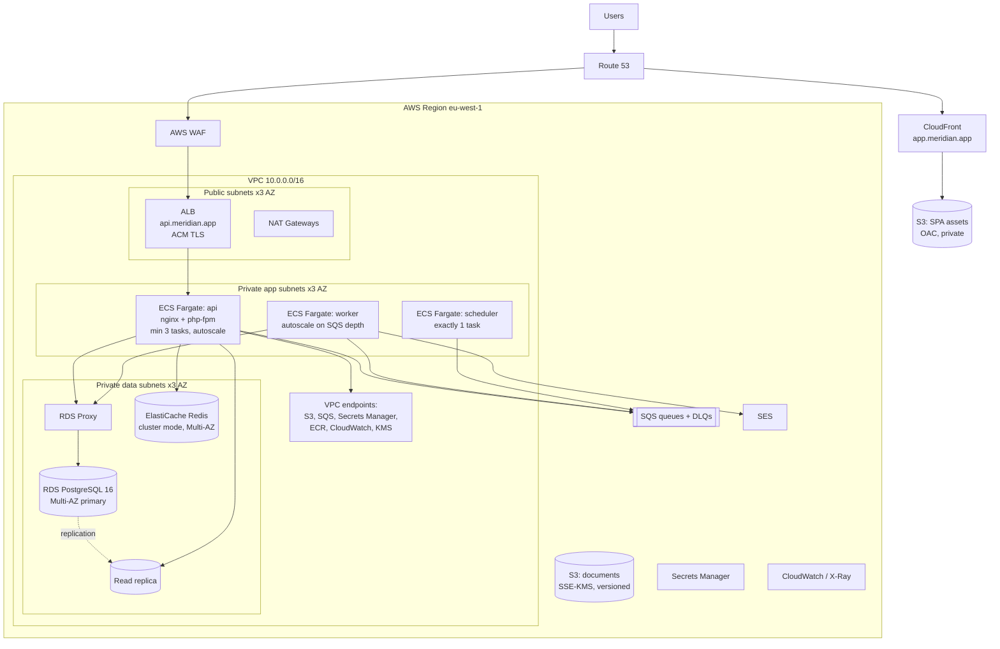

# 08 — Deployment Architecture

## 1. Environments

| Environment | Purpose | Infrastructure | Data |
|---|---|---|---|
| **Local** | Development | `docker-compose`: api, worker, scheduler, web (Vite), postgres, redis, localstack (S3/SQS/SES), mailpit | Seeded demo tenant |
| **Preview** (optional) | Per-PR review | Single ECS service per PR on shared staging cluster, ephemeral DB schema | Seeded demo data |
| **Staging** | Release candidate, E2E, load tests | Same Terraform modules as production, smaller instance sizes, single-AZ RDS | Synthetic data only — never production copies |
| **Production** | Customers | Multi-AZ, separate AWS account | Real |

Each environment is a **separate AWS account** in an AWS Organization (management, shared-services/ECR, staging, production, log-archive). This limits the damage of a compromised credential.

## 2. Production Topology



### Component choices

| Component | Choice | Reasoning |
|---|---|---|
| Compute | **ECS Fargate** | No servers or Kubernetes control plane to run. Good fit for a stateless PHP app and a small team. EKS only justified with many services. |
| Web server | nginx + php-fpm in one task (two containers) | Proven, predictable. Laravel Octane (Swoole/FrankenPHP) is an optional later optimisation once memory-leak risk in dependencies is assessed. |
| Database | RDS PostgreSQL Multi-AZ + RDS Proxy | Managed failover (~60–120 s), Proxy pools connections from many Fargate tasks and shortens failover for clients. |
| Cache/sessions | ElastiCache Redis Multi-AZ | Sessions, cache, locks, rate limits |
| Queues | **SQS** (standard) per workload: `default`, `notifications`, `exports`, `webhooks` + DLQ each | Fully managed, durable, scales to zero ops. Redis queues would put durability on the cache. |
| Frontend | S3 + CloudFront | Static, cached at edge, near-zero cost; atomic deploys by uploading a new build then switching `index.html` |
| Files | S3 with presigned URLs, SSE-KMS, versioning, GuardDuty malware scan | API never proxies file bytes |
| Email | SES with DKIM/SPF/DMARC | |
| Secrets | Secrets Manager (DB creds rotated every 30 days), injected as ECS secrets | No secrets in images or env files |
| Edge security | WAF on ALB and CloudFront, Shield Standard | |

## 3. Container Image

Multi-stage Dockerfile (`infra/docker/api/Dockerfile`):

```text
Stage 1 vendor   : composer:2 → composer install --no-dev --classmap-authoritative
Stage 2 runtime  : php:8.3-fpm-alpine
                   + extensions: pdo_pgsql, redis, intl, bcmath, opcache, pcntl
                   + opcache.validate_timestamps=0, JIT off
                   + copy app + vendor
                   + php artisan config/route/event/view cache at container start (env-specific)
                   + non-root user (uid 10001), read-only root filesystem, /tmp as tmpfs
```

- Same image runs as `api`, `worker` (`php artisan queue:work sqs --max-time=3600`) and `scheduler` (`php artisan schedule:work`).
- Image tagged with the **git SHA**; tags are immutable in ECR. Scanned by ECR enhanced scanning (Inspector) and Trivy in CI.
- SBOM generated (Syft) and attached to the release.

## 4. CI/CD Pipeline (GitHub Actions)

```mermaid
flowchart LR
    PR[Pull request] --> CI
    subgraph CI [ci.yml - on every PR]
        L[Lint & static analysis<br/>Pint, Larastan, ESLint, tsc]
        T[Tests<br/>Pest + Vitest<br/>with Postgres & Redis services]
        A[Arch + contract tests]
        S[Security<br/>composer audit, npm audit,<br/>Trivy, gitleaks, Semgrep]
        B[Build images<br/>no push]
    end
    CI --> MERGE[Merge to main]
    MERGE --> BUILD[Build & push image<br/>tag = SHA, SBOM, sign with cosign]
    BUILD --> STG[Deploy staging]
    STG --> E2E[Playwright E2E + smoke + k6 smoke]
    E2E --> GATE{Manual approval<br/>GitHub Environment}
    GATE --> PRD[Deploy production<br/>blue/green]
    PRD --> VERIFY[Smoke tests + alarm watch 15 min]
    VERIFY -- alarm --> RB[Automatic rollback]
```



- **AWS access via GitHub OIDC** — no long-lived AWS keys in GitHub. Each environment has its own IAM role, trust limited to the repo and environment.
- **Terraform** runs in a separate workflow: `plan` on PR (posted as a comment), `apply` on merge with approval for production. State in S3 with DynamoDB locking, per account.
- Branch protection: required reviews (CODEOWNERS), required checks, linear history, signed commits.

## 5. Release Process — Zero Downtime

```text
1. Run migrations         one-off ECS task: php artisan migrate --force  (as meridian_migrator role)
                          migrations are backward-compatible (expand/contract, see 03 §6)
2. Sync permissions       php artisan access:sync-permissions
3. Deploy API             CodeDeploy blue/green on ALB:
                            - new task set (green) starts, health checks pass
                            - 10% traffic canary for 5 min, CloudWatch alarms watched
                            - shift 100%, keep blue 15 min for instant rollback
4. Deploy workers         rolling update; workers stop gracefully (SIGTERM → finish current job, max 60 s)
5. Deploy scheduler       stop old → start new (one instance only)
6. Deploy SPA             upload hashed assets → upload index.html (no-cache) → CloudFront invalidation of /index.html
```

**Rollback:** CodeDeploy shifts traffic back to blue automatically when alarms fire (5xx rate, p95 latency, health-check failures). Because migrations are additive, the previous version still works against the new schema.

**Feature flags** separate *deploy* from *release*: risky features ship dark and are enabled per tenant.

## 6. Scaling

| Service | Policy |
|---|---|
| API | Target tracking: CPU 60%, ALB requests per target 400; min 3 (one per AZ), max 30 |
| Worker | Step scaling on `ApproximateNumberOfMessagesVisible` / age of oldest message per queue; min 1, max 20 |
| RDS | Vertical (Graviton instances), read replica for reporting; storage autoscaling |
| Redis | Cluster mode, add shards when memory > 70% |

## 7. Networking & Security

- Three subnet tiers across three AZs. Only the ALB and NAT gateways are public.
- Security groups by reference: ALB → API (port 8080), API/worker → RDS Proxy (5432), → Redis (6379). No `0.0.0.0/0` inbound except ALB 443.
- VPC endpoints keep AWS API traffic off the internet and reduce NAT cost.
- ECS task roles follow least privilege: API can `s3:PutObject` only on the document bucket prefix `tenants/*`, workers can send on SES, etc.
- No SSH or bastion. Emergency DB access through **SSM Session Manager port forwarding** with IAM auth, audited in CloudTrail.
- CloudTrail (org-wide) → log-archive account, GuardDuty, Security Hub, AWS Config conformance packs.

## 8. Backup & Disaster Recovery

| Item | Strategy | RPO / RTO |
|---|---|---|
| PostgreSQL | Automated backups + PITR (35 days), AWS Backup daily snapshots copied to a second region | RPO 5 min / RTO 1 h |
| S3 documents | Versioning + Cross-Region Replication | RPO minutes |
| Redis | Not a source of truth (sessions only); loss = users log in again | — |
| Infrastructure | Terraform recreates everything in the DR region | RTO 4 h for full region loss |

**DR drills:** quarterly restore of the latest snapshot into an isolated account, run the test suite against it, record the time taken in `docs/runbooks/dr-drill-log.md`.

## 9. Cost Awareness (indicative, production baseline)

| Item | Approx. monthly (USD) |
|---|---|
| Fargate (3 API + 2 worker + 1 scheduler, 1 vCPU/2 GB) | ~250 |
| RDS db.r7g.large Multi-AZ + replica | ~550 |
| ElastiCache cache.r7g.large × 2 | ~300 |
| ALB, NAT (×3), VPC endpoints | ~200 |
| CloudFront, S3, SQS, SES, CloudWatch | ~100 |
| **Total** | **~1,400** |

Staging uses single-AZ, smaller instances and scheduled scale-to-zero outside working hours (~15% of production cost).

## 10. Local Development

```text
make up        # docker compose up -d, waits for health
make migrate   # migrate + seed demo tenant (acme) with 500 employees
make test      # backend + frontend tests in containers
make types     # regenerate TS types from openapi.yaml
make e2e       # Playwright against the local stack
```

`localstack` provides S3/SQS/SES so the full flow (upload, queue, email in Mailpit) works offline.
