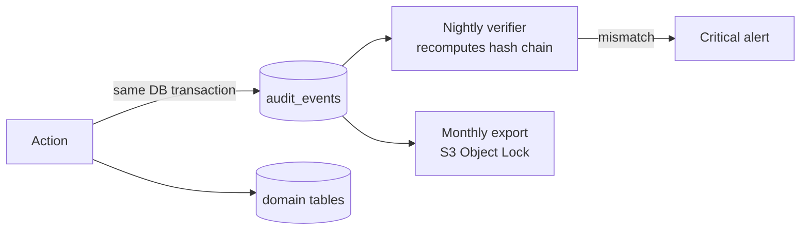

# 09 — Logging & Observability Strategy

Observability answers three questions: **Is it working?** (metrics, alarms) **Where is it broken?** (traces) **Why?** (logs). The **audit trail** answers a fourth, business question: **Who changed what, and when?** These are separate concerns with separate storage, retention and access rules.

| Signal | Tool | Retention | Audience |
|---|---|---|---|
| Application logs | Monolog (JSON) → stdout → CloudWatch Logs | 30 days hot, 1 year in S3 (Glacier IR) | Engineers |
| Traces | OpenTelemetry SDK → ADOT collector sidecar → AWS X-Ray | 30 days | Engineers |
| Metrics | CloudWatch (EMF from logs + container insights) | 15 months | Engineers, on-call |
| Errors | Sentry (backend + frontend, PII scrubbing on) | 90 days | Engineers |
| Audit events | PostgreSQL `audit_events` (hash-chained) → S3 Object Lock | 7 years | Tenant admins, compliance |
| AWS activity | CloudTrail → log-archive account | 1+ year | Security |

## 1. Structured Application Logs

All logs are single-line JSON written to `stdout`; the container platform ships them. No log files inside containers.

```json
{
  "timestamp": "2026-11-10T08:15:02.481Z",
  "level": "warning",
  "message": "Leave request rejected: insufficient balance",
  "service": "meridian-api",
  "env": "production",
  "version": "3f9a1c2",
  "process": "api",
  "request_id": "5f0c1e8a-2b1d-4c9e-9a7f-0e3c2d1b4a55",
  "trace_id": "1-6730a8e2-4c1b9f0e2d3a5b6c7d8e9f01",
  "tenant_id": "0193a4c2-…",
  "user_id": "0193a4c9-…",
  "route": "POST /api/v1/leave-requests",
  "module": "Leave",
  "context": {
    "leave_request_id": "0193b1…",
    "requested_days": 5,
    "available_days": 2.5
  },
  "duration_ms": 84
}
```

### Implementation

| Piece | Responsibility |
|---|---|
| `AssignRequestId` middleware | Reads `X-Request-Id` or generates a UUIDv7; returns it on the response |
| `Log::withContext()` in middleware | Adds `request_id`, `tenant_id`, `user_id`, `route` to every log line of the request |
| `ContextProcessor` (Monolog) | Adds `service`, `env`, `version`, `process`, `trace_id` |
| `PiiRedactionProcessor` | Masks keys matching a deny-list (`password`, `token`, `national_id`, `date_of_birth`, `salary`, `phone`, `email`, `authorization`, `cookie`) and patterns (card-like numbers, JWTs). Unit-tested. |
| Queue job middleware | Restores `request_id`, `tenant_id`, `user_id` from job payload so a request and its async work share the same `request_id` |
| `JsonFormatter` | One line per entry, ISO-8601 UTC timestamps, exceptions serialised with class, message, file:line, and a trimmed stack trace |

### Log level guide

| Level | Use for | Example |
|---|---|---|
| `debug` | Diagnostic detail; **disabled in production** | Query plans, payload shapes |
| `info` | Significant business or lifecycle events | `Employee terminated`, `Export completed (rows=4120)` |
| `notice` | Normal but noteworthy | Feature flag toggled |
| `warning` | Unexpected but handled; business rule rejections | Insufficient balance, retrying external call |
| `error` | Operation failed, needs attention | Job failed after final retry, IdP JWKS fetch failed |
| `critical` | Component unavailable | Cannot connect to database |
| `alert` / `emergency` | Data integrity risk | Audit hash chain mismatch, ledger/balance drift |

### Rules

- Log **events with context**, not prose: `Log::info('leave_request.approved', [...])`.
- Never log request/response bodies by default. Never log secrets or PII values — IDs only.
- Every `catch` either rethrows or logs with context; empty catches fail the Larastan rule set.
- 4xx responses are logged at `info`/`warning`; only 5xx are `error`. This keeps the error rate meaningful.
- HTTP access logs come from nginx (JSON) and include `request_id` and upstream time.

## 2. Distributed Tracing

- **OpenTelemetry PHP SDK** with auto-instrumentation for Laravel, PDO, Redis, HTTP client and queue.
- The SPA sends `traceparent` (W3C) with requests; the browser span links to the backend trace.
- Traces propagate into SQS messages as message attributes, so `request → job → email` is one trace.
- Sampling: 100% of errors and slow requests (tail-based in the ADOT collector), 10% of the rest.
- Custom spans around domain-heavy Actions (`ApproveLeaveRequest`, `CalculateWorkingDays`).

## 3. Metrics

### Golden signals (per service)

| Signal | Metric | Source |
|---|---|---|
| Latency | p50/p95/p99 by route | ALB + EMF from middleware |
| Traffic | Requests/min by route, tenant | EMF |
| Errors | 5xx rate, exception count by class | ALB, Sentry |
| Saturation | CPU/memory per task, php-fpm active/idle workers, DB connections, SQS queue age | Container Insights, php-fpm status exporter, RDS, SQS |

### Business metrics

`leave_requests_submitted`, `leave_approval_time_hours` (p50/p95), `logins_succeeded/failed`, `mfa_challenges_failed`, `exports_generated`, `webhook_delivery_failures`. These show product health and catch silent failures (e.g. zero logins in an hour on a weekday).

## 4. Alerting

Alerts are based on **symptoms that users feel** and SLOs, not on every cause.

| SLO | Target | Alert |
|---|---|---|
| API availability (non-5xx) | 99.9% / 30 days | Multi-window burn rate: 14.4× over 1 h **and** 5 min → page; 6× over 6 h → ticket |
| API latency | 95% of requests < 300 ms | p95 > 500 ms for 10 min → page |
| Queue freshness | Oldest message < 2 min | > 10 min for 5 min → page |

| Other alarms | Severity |
|---|---|
| DLQ message count > 0 | Ticket |
| RDS CPU > 80% 15 min, free storage < 15%, replica lag > 60 s | Ticket / page |
| Spike in 401/403 or failed logins per tenant | Security ticket |
| Audit chain verification failure | Page + security incident |
| Certificate expiry < 21 days | Ticket |

Routing: CloudWatch Alarms → SNS → PagerDuty/Opsgenie (page) or Slack (ticket). Every paging alert links to a runbook in `docs/runbooks/`.

## 5. Dashboards

1. **Service overview** — golden signals, deploy markers, error budget remaining.
2. **Dependencies** — RDS, Redis, SQS, SES health.
3. **Business** — logins, leave flow, exports per tenant.
4. **Security** — auth failures, lockouts, permission denials, admin role grants.

Dashboards are defined in Terraform, not clicked together.

## 6. Audit Trail (Business Audit Log)

Separate from technical logs: it is **data the product shows to customers**, so it lives in PostgreSQL with guarantees.

> **Implemented (Phase 4):** `Audit` module. Other modules call `Audit\Contracts\AuditRecorder` inside their transaction and build field diffs with `ChangeSet`, which masks sensitive values. Events are hash-chained, the model refuses edits, `php artisan audit:verify` checks the chain, and `GET /api/v1/audit-events` reads it (`audit.view`). Employee create, update, delete, restore and photo changes are audited. Security events (login, lockout and so on) are still only in the application log.

### What is audited

- Create/update/delete of employees, employment, compensation, documents, leave decisions and adjustments, attendance corrections.
- Security events: login, logout, failed login, MFA changes, password change, token creation, role/permission changes, impersonation, exports of personal data, views of sensitive fields (salary, national ID).

### How



- Written **in the same transaction** as the change (`AuditRecorder` called by Actions, not Eloquent observers — observers miss query-builder updates and lack business intent such as "approved" vs "updated").
- `changes` stores field-level diffs; sensitive values are masked (`"salary": ["***", "***"]`) while recording *that* they changed.
- **Tamper evidence:** each row stores `hash = SHA-256(prev_hash ‖ canonical_json(row))` per tenant chain. A nightly job verifies the chain; any edit or deleted row breaks it.
- DB role cannot `UPDATE`/`DELETE` audit rows.
- Tenant admins view and filter the trail in the UI (`/audit-events`), and can export it.

## 7. Correlation in Practice

A support ticket says: *"My leave approval failed at 10:14."*

1. Audit/UI shows the `request_id` (also displayed in the SPA error toast: "Reference: 5f0c1e8a").
2. CloudWatch Logs Insights:
   ```text
   fields @timestamp, level, message, context
   | filter request_id = "5f0c1e8a-2b1d-4c9e-9a7f-0e3c2d1b4a55"
   | sort @timestamp asc
   ```
3. Open `trace_id` in X-Ray to see the slow or failing span.
4. Sentry issue linked by the same `request_id` tag.

## 8. Frontend Observability

- Sentry React SDK: errors, unhandled promise rejections, React error boundaries, release tagging with source maps (uploaded in CI, not public).
- Web Vitals (LCP, INP, CLS) sent to a lightweight `/telemetry` endpoint → CloudWatch EMF.
- The `request_id` from failed API calls is shown to users so support can trace it.
