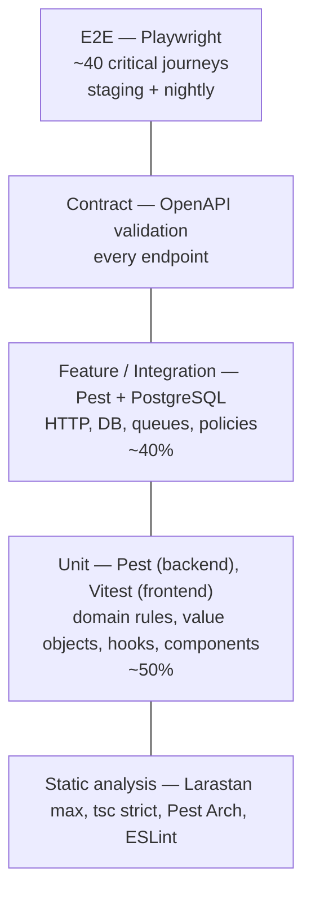

# 10 — Testing Strategy

## 1. Principles

1. **Test behaviour, not implementation.** Tests describe business rules ("an employee cannot approve their own leave"), so refactors do not break them.
2. **Fast feedback first.** Most tests run in milliseconds without a database; the full PR pipeline stays under 10 minutes.
3. **Real dependencies where it matters.** Repository and RLS tests run against real PostgreSQL 16 — never SQLite, which has different SQL, no RLS, no ltree, no exclusion constraints.
4. **Quality gates are automated.** If a rule matters, CI enforces it.
5. **Flaky tests are bugs.** A flaky test is quarantined within 24 h and fixed or deleted within a week.

## 2. Test Pyramid



## 3. Backend Testing

| Level | Tool | Scope | Database | Example |
|---|---|---|---|---|
| **Static** | Larastan (level max), Pint, Rector (dry run) | Types, dead code, style | — | Generic collection types, no `mixed` leaks |
| **Architecture** | Pest Arch | Module boundaries & layering | — | `expect('Meridian\Modules\Leave\Domain')->not->toUse('Illuminate')` |
| **Unit** | Pest | Domain entities, value objects, domain services | None | `WorkingDayCalculator` excludes weekends and public holidays, handles half days |
| **Integration** | Pest | Eloquent repositories, mappers, RLS, migrations, S3/SQS adapters (LocalStack) | PostgreSQL | Repository returns nothing under a different tenant context |
| **Feature** | Pest + Laravel HTTP testing | Endpoint → Action → DB → response; validation, authorisation, events dispatched, jobs queued | PostgreSQL | `POST /leave-requests/{id}/approve` as manager of another team → 404 |
| **Contract** | `league/openapi-psr7-validator` | Every feature test response is validated against `openapi.yaml` | — | Field renamed in Resource but not in spec → test fails |
| **Mutation** | Infection | Domain + Application layers | — | MSI ≥ 80% on `Domain` namespaces |

### Architecture rules (examples)

```text
arch('domain is framework-free')
    ->expect('Meridian\Modules\*\Domain')->not->toUse(['Illuminate', 'Laravel'])

arch('modules only talk through contracts')
    ->expect('Meridian\Modules\Leave')->not->toUse([
        'Meridian\Modules\Employee\Domain',
        'Meridian\Modules\Employee\Infrastructure',
    ])

arch('controllers are thin')
    ->expect('Meridian\Modules\*\Http\Controllers')->not->toUse('Illuminate\Support\Facades\DB')

arch('no debugging leftovers')->expect(['dd', 'dump', 'ray', 'var_dump'])->not->toBeUsed()
```

### Key test suites

| Suite | Why it exists |
|---|---|
| **Tenant isolation** | Two tenants with identical data; every repository and list endpoint is exercised under tenant B, asserting zero tenant A rows. Also asserts a query without `app.tenant_id` fails. |
| **RBAC matrix** | Data-driven: role × scope × permission × relationship → expected allow/deny. See [07 §11](07-rbac.md#11-testing-the-rbac-model). |
| **Route coverage** | Every `/api/v1` route has auth + permission middleware or an explicit public marker. |
| **Leave ledger** | Property-style tests: random sequences of accrue/request/approve/cancel never leave `leave_balances` ≠ `SUM(ledger)`. |
| **State machines** | Every invalid transition (e.g. `rejected → approved`) throws `InvalidStateTransition`. |
| **Audit** | Every Action that changes sensitive data writes exactly one audit event with masked values; hash chain verifies. |
| **Migrations** | `migrate:fresh` + `migrate:rollback --step=1` on CI; `squawk` lints SQL for unsafe locks. |
| **Concurrency** | Two parallel approvals of the same request → one succeeds, one gets 409/412. |

### Database strategy

- PostgreSQL 16 service container in CI with the same extensions as RDS (`ltree`, `pg_trgm`, `citext`, `btree_gist`).
- Feature tests wrap each test in a transaction (`RefreshDatabase` with `migrate` once per run); tests that need committed data (outbox, queue) use `DatabaseTruncation` on specific tables.
- **Parallel runs** with `pest --parallel` — one database per process.

### Test data

- **Factories** per module with meaningful states: `Employee::factory()->onNotice()->inDepartment($eng)->create()`.
- **Builders** for complex aggregates in unit tests (`LeaveRequestBuilder::aPendingRequest()->forDays(3)->build()`), no database needed.
- No shared global fixtures between tests; each test arranges what it needs.
- Fake time with `Carbon::setTestNow()` / `travelTo()` for accrual and expiry rules.
- Externals faked at the boundary: `Queue::fake()`, `Mail::fake()`, `Http::fake()`; S3/SQS adapters tested once against LocalStack.

## 4. Frontend Testing

| Level | Tool | Scope |
|---|---|---|
| **Static** | `tsc --noEmit` (strict), ESLint (incl. `jsx-a11y`, `boundaries`, `react-hooks`) | Types, imports, hooks rules |
| **Unit** | Vitest | Utilities, Zod schemas, formatters, permission helpers |
| **Component** | Vitest + Testing Library + user-event | Components tested the way users use them: by role and label, not CSS classes |
| **Integration** | Vitest + **MSW** | Whole feature pages with mocked API; MSW handlers generated from OpenAPI examples so mocks match the contract |
| **Accessibility** | `vitest-axe` on components, `@axe-core/playwright` in E2E | No serious/critical violations |
| **Visual** (optional) | Playwright screenshots of design-system components | Catch unintended UI changes |

Example behaviours tested:

- Leave request form shows remaining balance and blocks submit when requested days exceed it.
- Server `422` errors appear on the correct fields.
- The "Approve" button is hidden when `meta.permissions` lacks `approve`.
- Optimistic update rolls back when the API returns `409`.

## 5. End-to-End Testing

- **Playwright** against the full Docker stack locally and against staging after each deploy.
- Covers ~40 critical journeys only — E2E tests are slow and expensive to maintain:
  - Login with MFA, logout, session expiry
  - HR creates employee → employee receives invite → sets password → completes profile
  - Employee requests leave → manager approves → balance updates → employee notified (email via Mailpit API)
  - Department transfer updates manager's team view
  - Tenant admin creates custom role and assigns at department scope; user sees only that department
  - Document upload → download via presigned URL
  - Cross-tenant URL tampering returns 404
- Each test seeds its own tenant through a test-only API (enabled only outside production) so tests run in parallel.
- Traces, videos and screenshots saved as CI artifacts on failure.

## 6. Non-Functional Testing

| Type | Tool | When | Pass criteria |
|---|---|---|---|
| **Load** | k6 | Weekly on staging + before major releases | 200 req/s mixed workload: p95 < 300 ms reads / 600 ms writes, error rate < 0.1% |
| **Stress / soak** | k6 | Monthly | Find the breaking point; no memory growth over 2 h |
| **Security — SAST** | Semgrep (PHP, TS rules), Larastan security rules | Every PR | No high findings |
| **Security — dependencies** | `composer audit`, `npm audit`, Dependabot, Trivy (image) | Every PR + daily | No critical/high without an accepted exception |
| **Security — secrets** | gitleaks | Every PR + pre-commit | Zero findings |
| **Security — DAST** | OWASP ZAP baseline scan | Nightly on staging | No high alerts |
| **Resilience** | Manual game days / AWS FIS | Quarterly | RDS failover, Redis loss, SQS throttling: service recovers within SLO |
| **DR** | Restore drill | Quarterly | See [08 §8](08-deployment.md#8-backup--disaster-recovery) |

## 7. Quality Gates (CI)

| Gate | Threshold | Blocks merge |
|---|---|---|
| Larastan | level max, no new baseline entries | ✔ |
| `tsc` / ESLint | zero errors | ✔ |
| Pest Arch | all pass | ✔ |
| Backend coverage | ≥ 85% lines overall, ≥ 95% `Domain` | ✔ |
| Frontend coverage | ≥ 80% lines in `features/` | ✔ |
| Mutation score (Domain) | ≥ 80% MSI (nightly; drops open an issue) | — |
| Contract validation | all responses valid | ✔ |
| Security scans | no critical/high | ✔ |
| PR size | warn above 400 changed lines | — |

Coverage is a floor, not a goal; the mutation score is the better signal of test strength.

## 8. CI Execution Plan

```text
ci.yml (PR) — parallel jobs, target < 10 min
├── backend-static     Pint, Larastan, Rector --dry-run, composer audit
├── backend-tests      Pest --parallel (unit + arch + integration + feature + contract), coverage
├── frontend-static    tsc, ESLint, npm audit
├── frontend-tests     Vitest (unit + component + MSW), coverage
├── contract-sync      regenerate TS types from openapi.yaml → fail if git diff not empty
├── security           gitleaks, Semgrep, Trivy (fs)
└── docker-build       build images (no push), hadolint

nightly.yml
├── infection (mutation)
├── playwright full suite on staging
├── ZAP baseline
└── dependency freshness report
```

## 9. Definition of Done (testing)

A change is done when:

- [ ] Business rules have unit tests; endpoints have feature tests covering success, validation, authorisation (allowed + denied + other-tenant)
- [ ] OpenAPI updated; contract and type-sync checks pass
- [ ] Sensitive changes produce audit events (asserted)
- [ ] Migration is backward compatible and lint-clean
- [ ] New UI is keyboard-accessible and passes axe
- [ ] Logs and metrics added for new failure modes; runbook updated if a new alert was added
