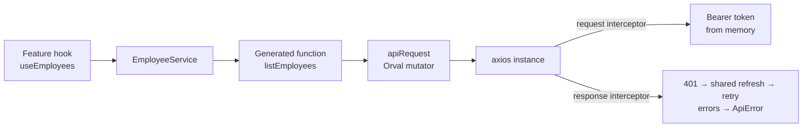
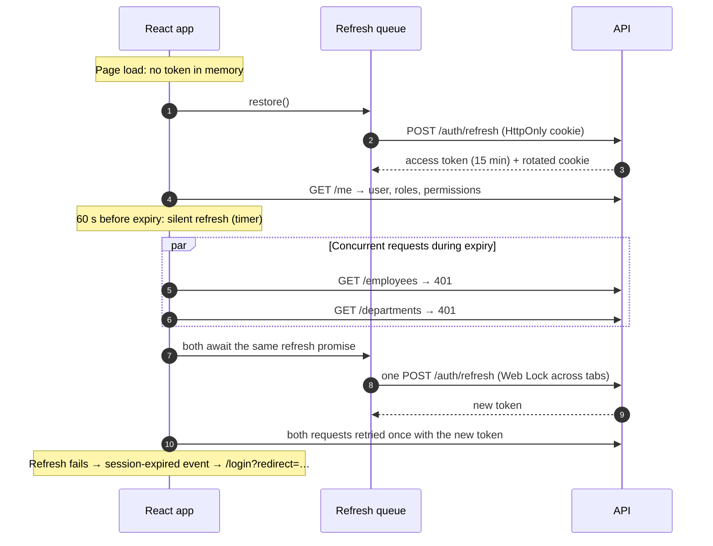

# 11 — Frontend Architecture

The React SPA in `apps/web`: React 19, TypeScript (strict), Vite, React Router 7, TanStack Query 5, React Hook Form + Zod, Tailwind CSS 4 with shadcn/ui conventions on Radix primitives, and Axios behind a client generated from the OpenAPI contract.

## 1. Principles

| Principle | In practice |
|---|---|
| **The API is the authority** | The UI hides what a user cannot do (permissions from `/me`), but every rule is enforced by the API. Server validation errors are shown on the fields they belong to. |
| **Contract-first** | No hand-written endpoint URLs. Orval generates a typed client from `packages/api-contract/spec/openapi.yaml`; CI fails if the generated code drifts from the spec. |
| **Server state ≠ client state** | API data lives in TanStack Query. The only client state is the session (in memory), the theme and URL state (filters, sort, cursor). There is no global store. |
| **Feature slices** | Each feature owns its pages, components, hooks and form schemas. Shared code lives in `components/`, `hooks/`, `services/` and `shared/`. |
| **Accessible by default** | Radix primitives for dialogs and menus, labelled form controls, `aria-sort`, `aria-busy`, a skip link, and focus moved to the page title on navigation. |

## 2. Folder Structure

```text
apps/web/
├── e2e/                         Playwright specs (real API + PostgreSQL)
├── public/
├── src/
│   ├── app/                     bootstrap: App, AppProviders, route table, router
│   ├── assets/
│   ├── components/              design system
│   │   ├── ui/                  primitives: button, input, select, checkbox, dialog (Modal/Drawer),
│   │   │                        dropdown-menu, avatar, badge, card, skeleton, tabs, progress, sonner (toasts)
│   │   ├── data-table/          generic DataTable (server-side sort, skeleton rows, empty state)
│   │   └── *.tsx                SearchInput, CursorPagination, EmptyState, ErrorState, FormField,
│   │                            ConfirmDialog, PageHeader, LoadingScreen, Stepper, FileDropzone
│   ├── features/                one folder per business area
│   │   ├── auth/                login, forgot/reset password, verify e-mail, banner
│   │   ├── dashboard/           page + widgets
│   │   ├── employees/           api/ (queries, mutations), hooks/, components/, lib/, pages/ — see docs/12
│   │   ├── departments/
│   │   ├── roles/
│   │   ├── settings/
│   │   └── errors/              not found, forbidden, route error boundary
│   ├── hooks/                   generic hooks (debounce, media query, object URL, form server errors, title)
│   ├── layouts/                 AppLayout (sidebar, top bar, breadcrumbs, menus), AuthLayout, navigation config
│   ├── routes/                  paths, guards (RequireAuth, GuestOnly, RequirePermission), route handles
│   ├── services/                ApiClient + one service per resource
│   │   ├── api/                 http-client (axios + Orval mutator), interceptors, session refresh,
│   │   │   │                    token store, ApiError, If-Match helper
│   │   │   └── generated/       ← Orval output, never edited by hand
│   │   └── *-service.ts         AuthService, EmployeeService, DepartmentService, RoleService, AuditService
│   ├── shared/                  auth (AuthProvider, useAuth), theme, config, lib (query client/keys, format, errors)
│   ├── styles/                  Tailwind entry and design tokens (light + dark)
│   ├── test/                    Vitest setup, MSW server/handlers/fixtures, renderApp()
│   └── types/                   permission keys, re-exported API types
├── orval.config.ts
├── playwright.config.ts
└── vite.config.ts               dev/preview proxy for /api, code-split vendor chunks, Vitest config
```

**Import rules** (enforced with ESLint `no-restricted-imports`): only `services/` and `types/api.ts` may import from `services/api/generated`. Features use the services and the re-exported types.

## 3. API Layer



- **Generated client:** `npm run api:generate` (Orval, `axios-functions` mode). Every operation is a typed function, for example `updateEmployee(id, body, options)`.
- **Services** translate application concepts into API parameters. For example, `EmployeeListQuery { statuses: ['active'] }` becomes `filter[status]=active`. They also unwrap envelopes and add `If-Match` from the record's version.
- **ApiError:** every failure becomes an `ApiError` with `status`, a stable `code`, a safe `detail`, `fieldErrors` and `requestId`. `describeError()` maps it to a user-facing title and description:

| Status | Shown as |
|---|---|
| 0 | "You appear to be offline" |
| 401 | Session ended → redirect to `/login?reason=expired` |
| 403 | "Access denied", or "Verify your e-mail address" for `email_not_verified` |
| 404 | "Not found" |
| 409 | The API's business message (e.g. "Another employee already uses this work e-mail address."), on the related field when there is one |
| 412 | "Someone else changed this record", with a Reload action |
| 422 | Messages next to each field |
| 429 | "Please wait N seconds" (from `Retry-After`) |
| 5xx | "Something went wrong" plus the request id for support |

## 4. Authentication Flow



| Requirement | Implementation |
|---|---|
| Refresh token in an HttpOnly cookie | Set by the API, scoped to `/api/v1/auth`; `axios` sends it with `withCredentials`. JavaScript never sees it. |
| Access token in memory only | `services/api/token-store.ts`, a module variable with subscribers. Nothing is written to `localStorage` or `sessionStorage`. |
| Silent refresh | `AuthProvider` schedules a refresh 60 s before expiry; the request interceptor also refreshes when a token has under 30 s left. |
| Queue concurrent refreshes | `refreshSession()` shares one in-flight promise in the tab. Across tabs, the **Web Locks API** serialises refreshes, because the API revokes the whole session if a rotated refresh token is replayed. |
| Automatic retry | The response interceptor retries each request that got a 401 once after a successful refresh (`retriedAfterRefresh` prevents loops). |
| Redirect on failure | `notifySessionExpired()` clears the token and dispatches an event. `AuthProvider` clears the query cache, and `RequireAuth` redirects to `/login?redirect=<current URL>&reason=expired`. |

**Routes:**
- Public (`GuestOnly`): `/login`, `/forgot-password`, `/reset-password`.
- Open to everyone: `/verify-email`. The API's signed verification link redirects here with `?status=verified|failed`.
- Protected (`RequireAuth` → `AppLayout`): `/dashboard`, `/employees[/new|/:id|/:id/edit]`, `/departments`, `/roles`, `/settings`.
- Per section: `RequirePermission` uses the permission keys from `/me`. No role names appear in the frontend.
- Redirects: `safeRedirect()` accepts only same-app paths, so there are no open redirects.

## 5. State Management

| State | Where | Notes |
|---|---|---|
| Server data | TanStack Query | Hierarchical keys (`shared/lib/query-keys.ts`); only transient failures are retried; `keepPreviousData` keeps tables steady between pages |
| Session and permissions | `AuthProvider` (React context) | Loading, authenticated or unauthenticated |
| Access token | `tokenStore` (module) | Outside React: the HTTP layer needs it synchronously |
| Theme | `ThemeProvider` + `localStorage` | Light, dark or system; an inline script in `index.html` prevents a flash of the wrong theme |
| List filters, sort, cursor | URL search params | Bookmarkable and shareable; the back button works (`useEmployeeListQuery`) |
| Table column choice | `localStorage` via `usePersistentState` | Per browser, validated on read |
| Form state | React Hook Form + Zod | Client rules mirror the API; server 409/422 errors are mapped back by `useFormServerErrors` |

**Mutations:**
- **Optimistic:** soft delete and restore remove the row from every cached list page at once, and roll back if the API refuses (e.g. 409 "has direct reports").
- **Create and update:** the response replaces the detail cache, and lists, headcount and audit queries are invalidated.
- **PATCH:** only changed fields are sent, with `If-Match`; a 412 offers a reload.

## 6. Component Design

- **shadcn/ui conventions:** components are local source, styled with Tailwind and `class-variance-authority`, and use semantic tokens (`bg-primary`, `text-muted-foreground`) defined once for light and dark (`styles/index.css`). `components.json` lets the shadcn CLI add more components consistently.
- **Radix primitives** handle the hard accessibility work: focus trapping, Escape to close, returning focus to the trigger, and ARIA roles.
- **Composition over configuration:** `Modal`/`Drawer` take a title, a description, content and a footer. `DataTable` takes columns, each with a `cell` renderer and an optional `sortField`. `FormField` wires the label, hint, error, `aria-invalid` and `aria-describedby` into whatever control it wraps.
- **States are first-class:** every data view handles loading (skeletons with `aria-busy`), empty (`EmptyState`), error (`ErrorState` with retry for transient failures) and success.
- **Performance:**
  - each page is a lazy chunk rendered inside `<Suspense>`;
  - vendor code is split into stable chunks;
  - `EmployeeAvatar` is memoised and photos are cached per record version;
  - list columns are memoised;
  - search input is debounced.

## 7. Accessibility and Responsiveness

- Skip link; focus moves to the page `<h1>` after each navigation; the document title updates per page.
- Every input has a label, and errors are announced through `aria-describedby`. The manager picker follows the WAI-ARIA 1.2 combobox pattern.
- Tables have captions, sortable headers expose `aria-sort`, and less important columns are hidden on small screens.
- Below `lg`, the sidebar becomes a drawer opened from the top bar; layouts are tested at phone, tablet and desktop widths.
- Motion is reduced for users with `prefers-reduced-motion`.
- `eslint-plugin-jsx-a11y` runs in CI.

## 8. Testing

| Level | Tools | What it covers |
|---|---|---|
| Unit | Vitest | Error mapping, URL state, form rules and payload diffing, theme |
| Integration | Vitest + Testing Library + MSW | The real app (providers, guards, lazy pages) against a mocked API: login, redirects, permission-hidden navigation, directory search/sort/paging, optimistic delete rollback, server errors on fields; the refresh queue with concurrent 401s |
| End-to-end | Playwright (desktop + mobile) | Built SPA + Laravel API + PostgreSQL: sign-in errors, session restore after reload, sign-out, employee wizard → edit → audit history → search → delete with reason → restore |

The employee module's components, state and API use are described in [12 — Employee Module](12-employee-module.md).

MSW fails any test that makes an unexpected request (`onUnhandledRequest: 'error'`).

## 9. Local Development

```bash
cd apps/web
cp .env.example .env.local      # optional; defaults proxy /api to http://127.0.0.1:8000
npm install
npm run dev                     # http://localhost:5173 (API must be running)
npm run api:generate            # after changing openapi.yaml
npm run lint && npm run typecheck && npm test
E2E_EMAIL=… E2E_PASSWORD=… npm run test:e2e
```

For E2E, create a verified user without putting the password in the shell history:

```bash
printf '%s' "$E2E_PASSWORD" | php apps/api/artisan identity:create-user e2e@meridian.test --name="E2E" --role=hr_admin --role=auditor --password-stdin --verified
```

Local E2E runs sign in many times per minute, so raise `AUTH_RATE_LIMIT_LOGIN_PER_ACCOUNT` in the API's `.env` (never in production).
