# 12 — Employee Module

The Employee Management module from end to end: the backend modules involved, the React feature, its state management and its use of the API.

| Directory | Profile |
|---|---|
| 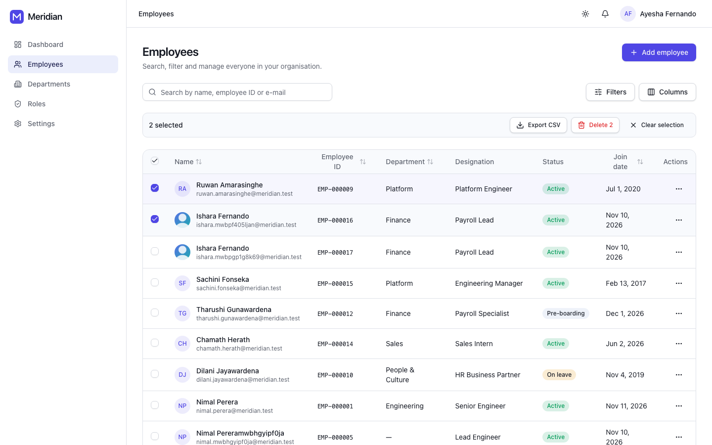 | 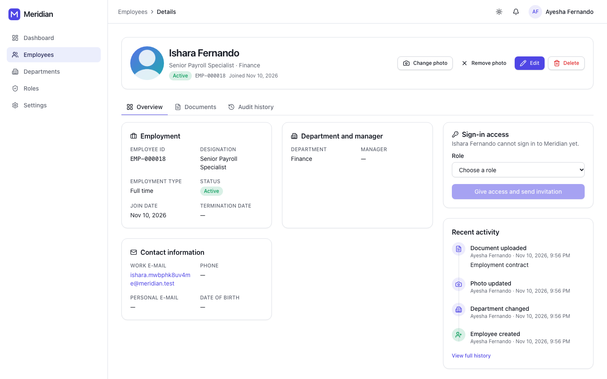 |
| **Advanced filters** | **Audit history** |
| 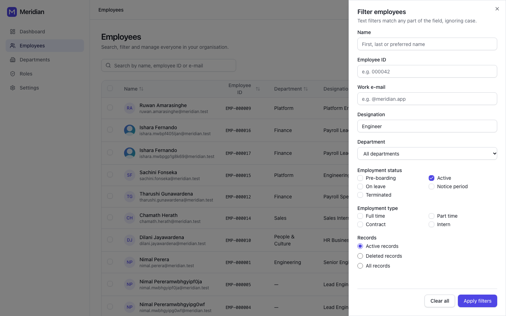 | 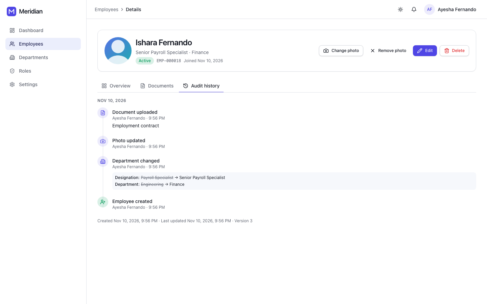 |
| **Create wizard** | **Review step** |
| 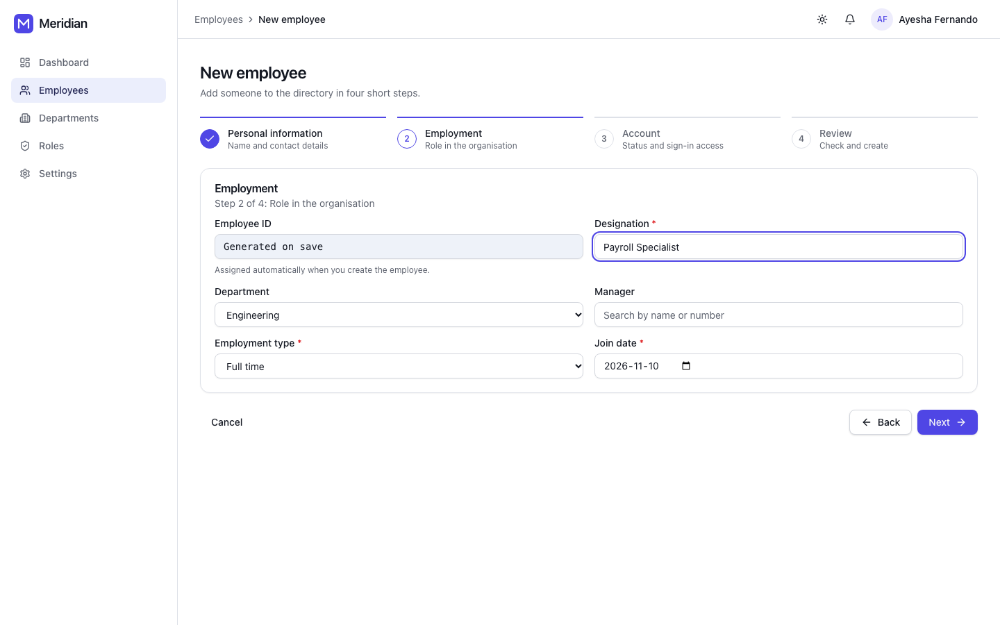 | 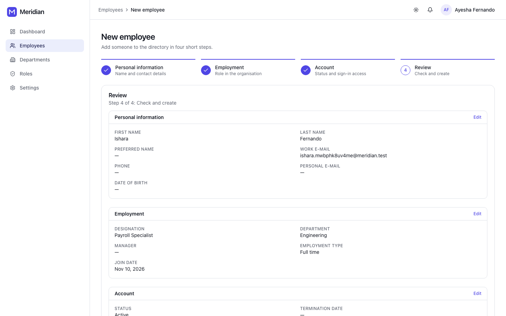 |
| **Edit conflict (412)** | **Photo crop** |
| 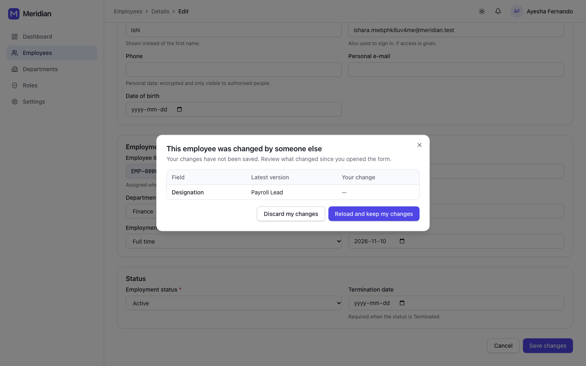 | 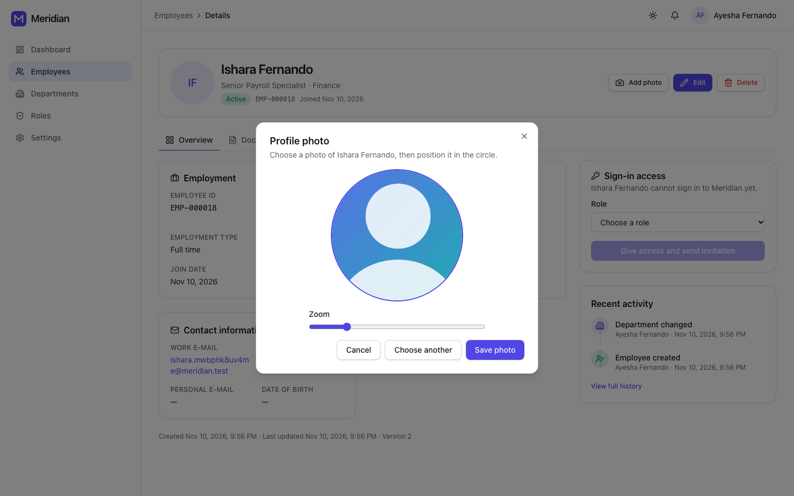 |
| **Documents** | **Phone** |
| 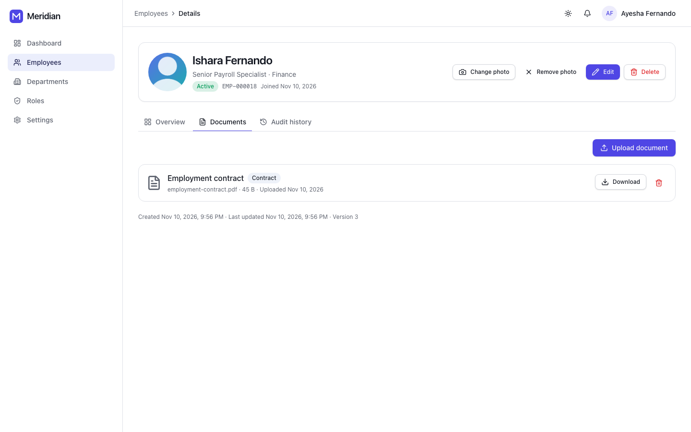 | 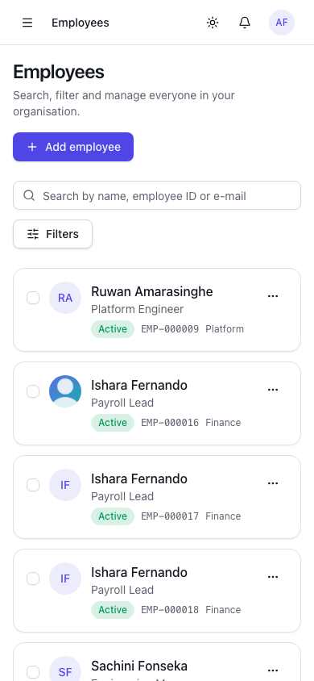 |

Screenshots are generated from the running app: `npm run docs:screenshots` in `apps/web` (see §6).

## 1. Architecture

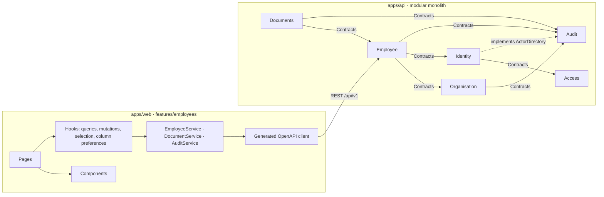

| Capability | Backend | Frontend |
|---|---|---|
| Directory | `GET /employees`: `q`, per-field filters (`name`, `employee_number`, `email`, `job_title`), status, type, department, deleted records, sort (incl. `department`), cursor pages | `EmployeeListPage`: URL-synced query, filter panel and chips, column selector, row selection, bulk actions, cards on phones |
| Create | `POST /employees`, optional `account: {role}` ([ADR-0007](adr/0007-employee-sign-in-accounts.md)) | `EmployeeCreateWizard`: four steps, per-step validation, review |
| Edit | `PATCH` with `If-Match`; 412 on a stale version | `EmployeeEditPage` + `EmployeeConflictDialog` |
| Delete / restore | Soft delete with a required reason; restore clears it | `EmployeeDeleteDialog` / `EmployeeRestoreDialog`, single or bulk, optimistic |
| Photo | Content-sniffed upload, private storage | `PhotoUploadDialog`: drag and drop, crop, progress |
| Documents | New `Documents` module | `EmployeeDocuments` tab |
| Sign-in access | `GET`/`POST /employees/{id}/account`, `PUT …/account/role` | `EmployeeAccountCard` |
| History | `GET /audit-events?filter[subject_id]=…` with actor names | `EmployeeAuditTimeline`, `EmployeeRecentActivity` |

**Backend decisions in this phase**
- **Department sort** without cross-module joins: a copy of the name on the employee, kept in sync by `DepartmentRenamed` ([ADR-0008](adr/0008-denormalised-department-name.md)).
- **Actor names in the audit trail:** Audit owns `ActorDirectory`; Identity implements it. Audit stays free of business modules, and names are resolved with one query per page.
- **Accounts:** Employee talks to Identity only through `AccountProvisioner`. Invitations are password-reset links queued after commit.
- **Documents:** a module of its own that depends on `Employee\Contracts\EmployeeDirectory`. Its events are recorded on the employee, so the profile history shows them.

## 2. Component Structure

```text
features/employees/
├── api/
│   ├── employee-queries.ts      useEmployees (next-page prefetch), useEmployee (placeholder from list cache),
│   │                            usePrefetchEmployee, useFetchLatestEmployee, useEmployeeHistory (infinite),
│   │                            useRecentActivity, useEmployeeAccount, useEmployeeDocuments, useHeadcount, useEmployeePhoto
│   └── employee-mutations.ts    create, update, delete/restore (optimistic, single and bulk), photo upload/remove,
│                                account create/role change, document upload/delete/download
├── hooks/                       useColumnPreferences (localStorage), useEmployeeSelection (across pages)
├── lib/                         form schemas and wizard steps, URL query state, labels, audit timeline presenter,
│                                edit-conflict diff/rebase, photo rules and crop maths, document rules, CSV export
├── components/
│   ├── EmployeeTable · EmployeeCard · EmployeeRowActions · EmployeeNameLink (prefetch on hover/focus)
│   ├── EmployeeSearch · EmployeeFilters (+ ActiveFilters chips) · EmployeeColumnSelector · EmployeeBulkActions
│   ├── EmployeeAvatar · EmployeeStatusBadge
│   ├── EmployeeFormSections (Personal, Employment, Status, AccountAccess) shared by
│   │   EmployeeForm (edit) and EmployeeCreateWizard
│   ├── EmployeeConflictDialog · EmployeeDeleteDialog · EmployeeRestoreDialog
│   ├── EmployeeDetailsPanel · EmployeeAccountCard · EmployeeDocuments · EmployeeAuditTimeline (+ recent activity)
│   ├── PhotoUploadDialog · ImageCropper · EmployeePicker (manager combobox)
└── pages/                       EmployeeListPage, EmployeeDetailPage (tabs), EmployeeCreatePage, EmployeeEditPage
```

New shared building blocks: `Tabs` (WAI-ARIA tabs, URL-controlled), `Stepper`, `Progress`, `FileDropzone`, `DataTable` row selection, `usePersistentState`, `settleAll` (bounded concurrency), `toCsv` (CSV-injection safe), `downloadFile`, `formatFileSize`.

**Composition:** form sections read the surrounding `FormProvider`, so the wizard and the edit form use the same fields, labels and rules. The table and the phone cards share `EmployeeRowActions`. Single and bulk delete share one dialog.

## 3. State Management

| State | Where | Notes |
|---|---|---|
| Directory query (search, filters, sort, cursor) | URL | Bookmarkable; changing anything but the cursor returns to page 1 |
| Visible columns | `localStorage` (`meridian.employees.columns`) | Validated on read; falls back to defaults if storage is unavailable |
| Selection | `useEmployeeSelection` | Kept across pages of the same result set and cleared when the filters change |
| Server data | TanStack Query | Keys under `employees.*` and `audit.*` (`shared/lib/query-keys.ts`) |
| Forms | React Hook Form + Zod | The wizard validates one step's fields at a time (`WIZARD_STEPS`) |
| Edit base version | `EditEmployee` state | The version being edited; the form is not reset by background refetches |

**Caching, invalidation, optimistic updates and prefetching**
- **Prefetch:**
  - the next directory page is prefetched when a page loads;
  - a profile is prefetched on hover or focus of a name;
  - opening a profile shows the row from the list cache at once (`placeholderData`) while the full record loads.
- **Optimistic:**
  - delete and restore (single and bulk) update every cached list page at once. A list showing *all records* keeps the row and flips its state; other lists drop it. All of it rolls back on error;
  - deleting a document is optimistic too.
- **Writes:**
  - create, update and photo writes put the response into the detail cache;
  - they then invalidate lists, headcount and audit queries;
  - account changes update the account cache.
- **Bulk actions** run one request per employee, at most four in parallel (`settleAll`), each with its own `If-Match`. One refusal (for example "has direct reports") is reported by name without blocking the others.

## 4. API Integration

Pages and components never call the API. Hooks call services (`EmployeeService`, `DocumentService`, `AuditService`, `RoleService`), and the services call the generated Orval client. ESLint blocks imports of `services/api/generated` outside `services/` and `types/api.ts`.

| Concern | How |
|---|---|
| Query translation | `toListEmployeesParams()` maps `EmployeeListQuery` (e.g. `recordState: 'deleted'`, `jobTitle`) to `filter[trashed]=only`, `filter[job_title]=…` |
| Concurrency | `ifMatch(version)` on update and delete; 412 → `EmployeeConflictDialog` |
| Uploads | `withUploadProgress()` passes Axios `onUploadProgress` through the generated client to a `Progress` bar |
| Downloads | Documents and photos are fetched as blobs with the bearer token, never as public URLs |
| Errors | `ApiError` + `describeError()`: 400, 401, 403, 404, 409, 412, 422, 429 and 5xx each get a clear message. `useFormServerErrors` puts 409/422 errors on their field; the wizard jumps to the step that owns the field |

**Conflict handling (never overwrite silently):**
1. The edit form sends only the changed fields, with the version it started from.
2. On 412 it fetches the latest version and lists what someone else changed, highlighting fields you both changed.
3. **Discard my changes** loads the latest version.
4. **Reload and keep my changes** loads the latest version and re-applies your edits as unsaved changes, so you review them and save again with the new version.

## 5. Accessibility and Responsiveness

- Tabs, the stepper, dialogs, menus and the manager combobox follow WAI-ARIA patterns, and everything works from the keyboard.
- The wizard moves focus to each step's heading. The photo cropper pans with the arrow keys.
- Form errors are linked with `aria-describedby`. Bulk selection counts are announced, and row checkboxes have names ("Select Nimal Perera").
- Layouts:
  - phones get cards;
  - tablets get a table with the essential columns;
  - desktops get every chosen column;
  - the filter panel is a side drawer.

## 6. Testing

| Level | What |
|---|---|
| Backend (Pest) | Delete reason, per-field filters and LIKE escaping, department sort across pages, rename sync, accounts (permissions, all-or-nothing creation, role changes, invitation), Documents (upload, validation, confidentiality, permissions), actor names; architecture rules for the new module |
| Unit (Vitest) | URL state, CSV escaping, bounded concurrency, timeline presenter, conflict diff/rebase, photo rules and crop maths, date formatting |
| Integration (Vitest + RTL + MSW) | Directory (filters, columns persisted, delete with reason and rollback, bulk delete with partial failure, restore, permission-based actions, phone cards, error and retry), wizard (step validation, account, server error jumps to its step, no account step without permission), edit conflict (keep or discard), late-loading department list, profile (tabs with keyboard, history, documents, hidden sections) |
| End-to-end (Playwright, desktop + mobile) | Wizard → edit → audit history → search → delete with reason → filter deleted records → restore |

`npm run docs:screenshots` (with `E2E_EMAIL`/`E2E_PASSWORD`, against a running stack) regenerates the images above. It runs a separate Playwright project that ordinary test runs ignore.
